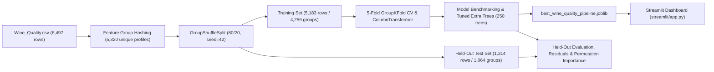
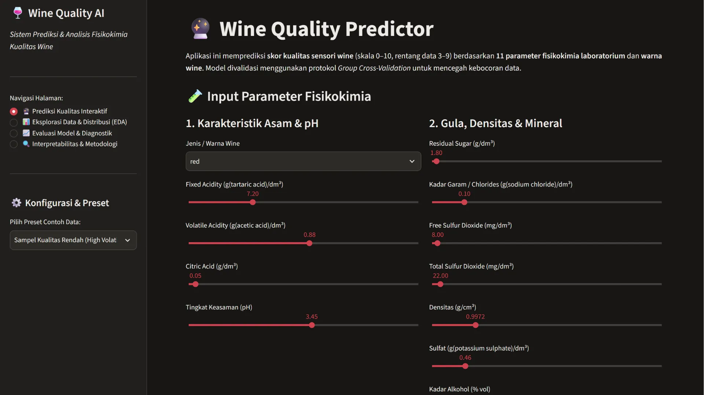
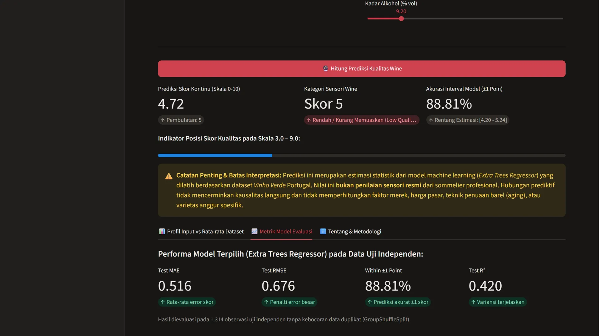
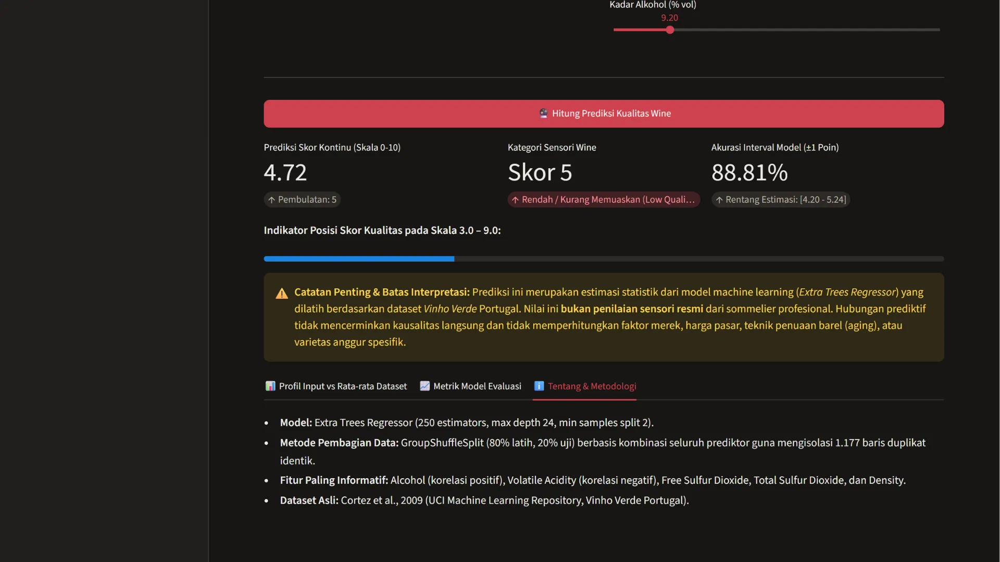
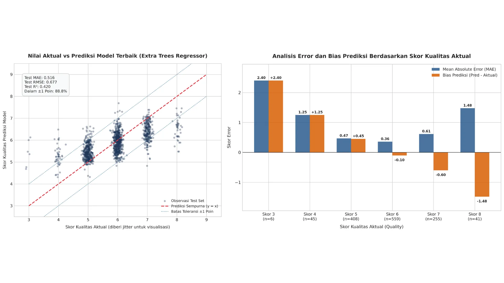
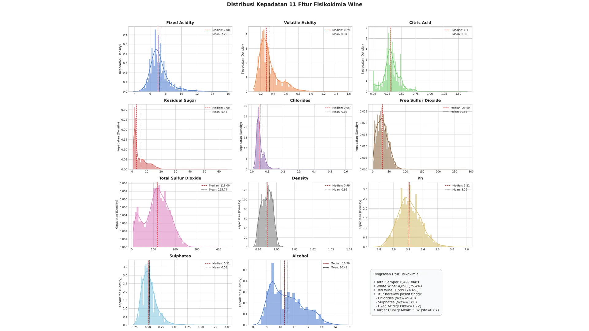
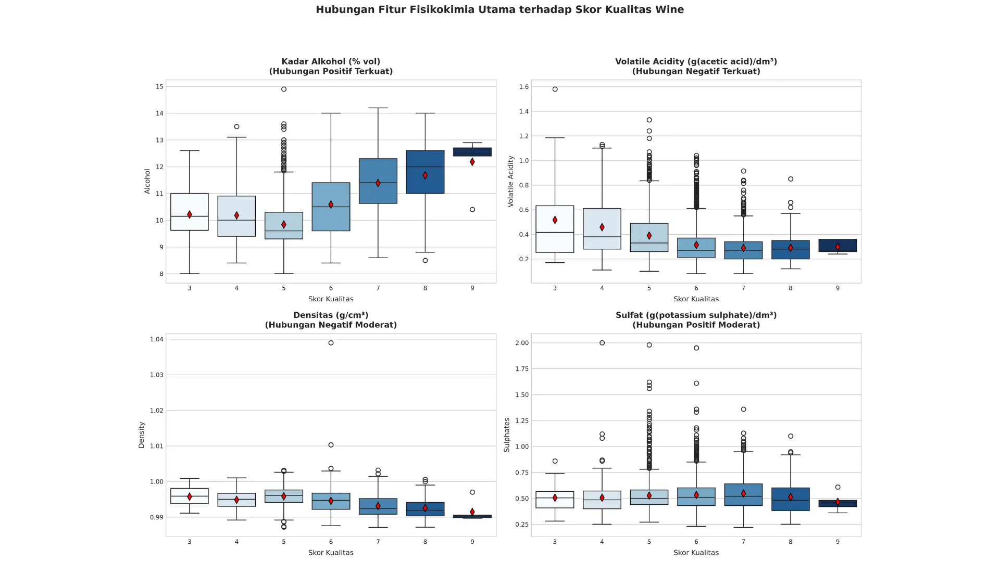
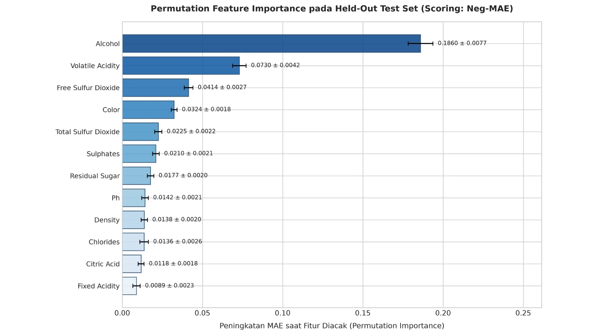
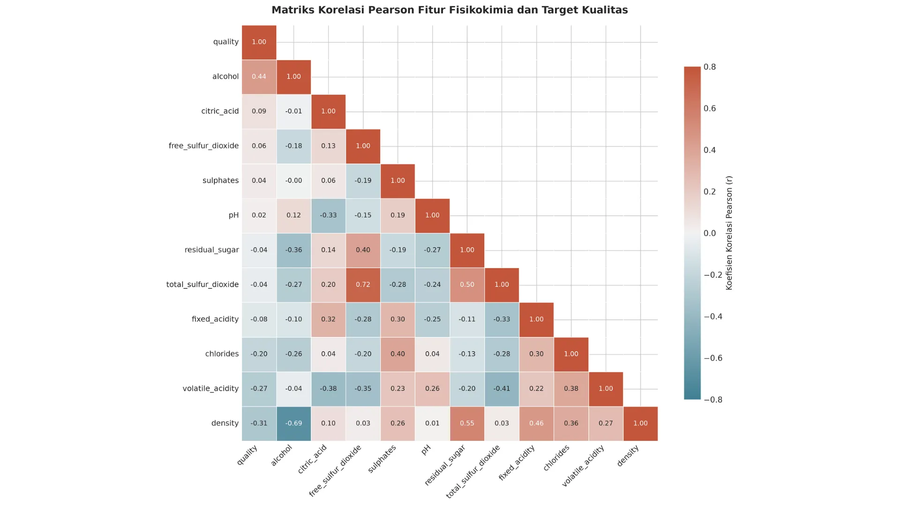

# Predicting Wine Quality from Physicochemical Properties


## Project Overview

Predicting Wine Quality from Physicochemical Properties is a supervised tabular regression project that estimates sensory wine quality scores from routine laboratory chemical measurements and wine color (`red` or `white`). Using the Portuguese *Vinho Verde* dataset of 6,497 samples, the pipeline prevents duplicate-profile data leakage via group-aware splitting (`GroupShuffleSplit` and 5-fold `GroupKFold`), benchmarks seven regression models, explains predictions with permutation feature importance, and serves interactive inference alongside diagnostic analytics in a four-page Streamlit application.

## Problem Statement & Objectives

Traditional wine quality grading relies on organoleptic evaluation by trained sommelier panels, which is time-consuming, costly, and subject to inter-panelist variability and sensory fatigue. Modeling sensory quality from standardized physicochemical tests provides an objective pre-screening baseline while addressing a subtle methodological pitfall: the presence of 1,177 identical duplicate rows in the dataset that cause optimistic evaluation bias under naive random splits.

- Build a leakage-free supervised regression pipeline mapping 11 physicochemical laboratory measurements and wine color to sensory quality scores.
- Construct a feature-profile `group_id` so identical chemical profiles never straddle training, cross-validation, and held-out test partitions.
- Benchmark baseline, linear, bagging, and gradient boosting regressors using 5-fold `GroupKFold` cross-validation and an independent 20% held-out test split.
- Quantify predictive drivers via held-out permutation feature importance and assess data leakage, deduplication, and white-wine-only sensitivity scenarios.
- Deliver a reproducible Python workflow and an interactive Streamlit dashboard for single-sample prediction, exploratory analysis, evaluation diagnostics, and interpretability.

## Data & Input Sources

The project uses the Portuguese *Vinho Verde* wine dataset stored in [`dataset/original/Wine_Quality.csv`](dataset/original/Wine_Quality.csv) along with UCI Machine Learning Repository metadata in [`dataset/original/metadata.json`](dataset/original/metadata.json). While `metadata.json` (UCI ID 186) documents 4,898 white wine instances with 11 numeric features, the actual CSV contains all 6,497 combined records (4,898 white wine and 1,599 red wine) plus the categorical `color` column, which is retained as experimental ground truth and evaluated separately in sensitivity testing.

| Attribute | Description |
| :--- | :--- |
| Dataset / Input Source | Wine Quality Dataset (Portuguese *Vinho Verde*, Cortez et al., 2009) |
| Source | [`dataset/original/Wine_Quality.csv`](dataset/original/Wine_Quality.csv) & [`dataset/original/metadata.json`](dataset/original/metadata.json) (UCI ID 186) |
| Format | CSV (`Wine_Quality.csv`) and JSON (`metadata.json`) |
| Samples / Records | 6,497 rows (4,898 white wine, 1,599 red wine; 5,320 unique feature profiles) |
| Features / Input Shape | 12 predictor features (11 continuous `float64` physicochemical properties + 1 categorical `color` feature) |
| Target / Label | `quality` (`int64`, discrete ordinal sensory score ranging from 3 to 9; mean 5.82, std 0.87) |

## Data Preprocessing & Feature Engineering

Data auditing in [`src/data_audit.py`](src/data_audit.py) confirms zero missing values across all 13 columns, 1,177 exact duplicate rows (2,169 rows within duplicate groups across 5,320 unique feature profiles), and zero conflicting quality labels within any identical profile group. To prevent identical rows from leaking across splits, `group_id` is assigned via `df.groupby(features).ngroup()` before splitting and preprocessing.

| Component | Transformation | Target Features | Purpose |
| :--- | :--- | :--- | :--- |
| Leakage Grouping | `groupby(features).ngroup()` | All 12 predictor columns | Isolates identical physicochemical profiles into atomic `group_id` clusters |
| Group Partitioning | `GroupShuffleSplit(test_size=0.20, random_state=42)` | Full dataset (6,497 rows) | Produces 5,183 train rows (4,256 groups) and 1,314 test rows (1,064 groups) with 0 overlap |
| Linear Preprocessor | `StandardScaler()` + `OneHotEncoder(drop="first")` | 11 numeric features + `color` | Standardizes feature scales and encodes wine color for Linear and Ridge regression |
| Tree Preprocessor | `"passthrough"` + `OneHotEncoder(drop=None)` | 11 numeric features + `color` | Preserves raw physical units for tree splits while one-hot encoding `color` |

1. Load [`dataset/original/Wine_Quality.csv`](dataset/original/Wine_Quality.csv) and verify schema, missing counts, skewness, and value ranges.
2. Compute `group_id` from all 12 predictor features excluding `quality` and confirm zero label conflicts across duplicate groups.
3. Partition the dataset into an 80% training set (5,183 rows) and a 20% held-out test set (1,314 rows) using `GroupShuffleSplit`.
4. Fit `ColumnTransformer` preprocessing pipelines strictly inside each training fold during cross-validation and on the full training set prior to held-out evaluation.

## Tech Stack

| Category | Technology | Purpose |
| :--- | :--- | :--- |
| Programming Language | Python | Core implementation for auditing, EDA, modeling, sensitivity tests, and UI |
| ML & Preprocessing | Scikit-learn | `ColumnTransformer`, `GroupShuffleSplit`, `GroupKFold`, regressors, and permutation importance |
| Data Manipulation | Pandas | CSV ingestion, duplicate profiling, group aggregation, and tabular metric summaries |
| Numerical Computing | NumPy | Array operations, metric calculations, residual statistics, and seeded reproducibility |
| Visualization | Matplotlib & Seaborn | High-resolution 300 DPI EDA, model comparison, residual, and importance figures |
| Model Persistence | Joblib | Serializing and loading the trained `best_wine_quality_pipeline.joblib` artifact |
| Interactive Web App | Streamlit | Four-page dashboard for live prediction, EDA inspection, diagnostics, and methodology |

## Machine Learning Approach

The task is formulated as a supervised tabular regression problem because sensory `quality` scores (3 to 9) carry meaningful ordinal distance, enabling continuous score estimation and direct magnitude error measurement via MAE and RMSE. Tree-based ensemble regressors are evaluated alongside linear baselines because several physicochemical variables exhibit pronounced positive skew (such as `chlorides` at +5.40) and non-linear interactions across wine colors.

| Attribute | Value |
| :--- | :--- |
| Learning Paradigm | Supervised Learning |
| Problem Domain | Oenology & Physicochemical Tabular Analytics |
| ML Task | Tabular Regression |
| Input Representation | 11 laboratory physicochemical measurements (`float64`) + `color` (`red` / `white`) |
| Target Output | Continuous quality estimate compared against ground-truth `quality` (3–9) |
| Validation Protocol | `GroupShuffleSplit` (80/20 held-out split) + 5-fold `GroupKFold` CV |

## Model Overview

Seven regression models wrapped in Scikit-learn `Pipeline` objects are benchmarked under identical group-aware splits, with a tuned `ExtraTreesRegressor` selected as the primary production model based on cross-validation and held-out test performance.

| Model | Role | Algorithm / Architecture | Preprocessing |
| :--- | :--- | :--- | :--- |
| `ExtraTreesRegressor` | Primary Selected Model | 250 extremely randomized decision trees (`max_depth=24`, `min_samples_split=2`) | Tree `ColumnTransformer` |
| `RandomForestRegressor` | Bagging Benchmark | 150 bootstrap decision trees (`max_depth=16`, `min_samples_split=4`) | Tree `ColumnTransformer` |
| `HistGradientBoostingRegressor` | Boosting Benchmark | Histogram-based gradient boosting (`max_iter=150`, `learning_rate=0.08`, `max_leaf_nodes=31`) | Tree `ColumnTransformer` |
| `Ridge` | Regularized Linear Benchmark | L2-regularized linear regression (`alpha=10.0`) | Linear `ColumnTransformer` |
| `LinearRegression` | Linear Benchmark | Ordinary least squares linear regression | Linear `ColumnTransformer` |
| `DummyRegressor` (Median / Mean) | Baseline Benchmarks | Constant median (`6.0`) and mean (`~5.81`) predictors | Linear `ColumnTransformer` |

## ML Workflow

1. **Data Audit & Leakage Verification** ([`src/data_audit.py`](src/data_audit.py)): Inspects dimensions, missing values, skewness, and 1,177 duplicate rows; constructs `group_id`; and verifies zero group overlap in the 80/20 `GroupShuffleSplit`.
2. **Exploratory Data Analysis** ([`src/eda.py`](src/eda.py)): Generates five 300 DPI diagnostic plots covering target distribution, 11 feature KDE histograms, Pearson correlation matrix, color-stratified quality, and key feature boxplots.
3. **Group Cross-Validation & Model Benchmarking** ([`src/modeling.py`](src/modeling.py)): Evaluates all seven regression pipelines on the 5,183-row training set using 5-fold `GroupKFold`.
4. **Final Training & Held-Out Evaluation** ([`src/modeling.py`](src/modeling.py)): Fits the tuned Extra Trees pipeline (`n_estimators=250`, `max_depth=24`, `min_samples_split=2`) and evaluates overall, red-only, white-only, and per-score error metrics on the 1,314-row held-out test set.
5. **Diagnostics, Explainability & Persistence** ([`src/modeling.py`](src/modeling.py)): Computes 15-repeat permutation feature importance on the held-out test set, saves evaluation plots, and exports [`models/best_wine_quality_pipeline.joblib`](models/best_wine_quality_pipeline.joblib) and [`models/evaluation_results.json`](models/evaluation_results.json).
6. **Sensitivity & Leakage Experiments** ([`src/sensitivity.py`](src/sensitivity.py)): Compares `GroupShuffleSplit` against naive `train_test_split`, evaluates a 5,320-row deduplicated dataset, and tests a 4,898-row white-wine-only subset, saving results to [`models/sensitivity_results.json`](models/sensitivity_results.json).
7. **Interactive Application Serving** ([`streamlit/app.py`](streamlit/app.py)): Loads the serialized pipeline and JSON results to deliver real-time quality predictions, input-vs-median profiling, and diagnostic dashboards.

## ML Pipeline Architecture

The end-to-end architecture ensures strict isolation between feature-group splitting, fold-level preprocessing, cross-validation benchmarking, serialized artifact generation, and interactive inference.



## Model Training & Configuration

Training and evaluation are executed via [`src/modeling.py`](src/modeling.py) with `RANDOM_SEED = 42` across splitting, model initialization, and permutation shuffling. Every candidate model is wrapped inside a `Pipeline` with its corresponding `ColumnTransformer` so scaling and one-hot encoding are fitted exclusively on training folds.

| Parameter / Setting | Configured Value | Scope |
| :--- | :--- | :--- |
| Random Seed | `42` | Global (`np.random.seed`, splits, estimators, permutation importance) |
| Train / Test Split | `GroupShuffleSplit(n_splits=1, test_size=0.20)` | 5,183 train rows / 1,314 test rows |
| Cross-Validation | `GroupKFold(n_splits=5)` | Executed exclusively on the 5,183-row training set |
| Primary Model (`ExtraTreesRegressor`) | `n_estimators=250`, `max_depth=24`, `min_samples_split=2`, `n_jobs=-1` | Tuned final pipeline saved to `.joblib` |
| `RandomForestRegressor` | `n_estimators=150`, `max_depth=16`, `min_samples_split=4`, `n_jobs=-1` | Benchmark comparison model |
| `HistGradientBoostingRegressor` | `max_iter=150`, `learning_rate=0.08`, `max_leaf_nodes=31` | Benchmark comparison model |
| `Ridge` | `alpha=10.0` | Regularized linear benchmark |

```python
best_et_params = {"n_estimators": 250, "max_depth": 24, "min_samples_split": 2}
best_pipeline = Pipeline([
    ("prep", preprocessor_tree),
    ("reg", ExtraTreesRegressor(**best_et_params, random_state=42, n_jobs=-1)),
])
```

## Hyperparameter Tuning & Experiment Tracking

Hyperparameter selection for the `ExtraTreesRegressor` was conducted against 5-fold `GroupKFold` cross-validation MAE, exploring `n_estimators` (`[150, 200, 250]`), `max_depth` (`[16, 20, 24, None]`), and `min_samples_split` (`[2, 3]`), alongside controlled sensitivity experiments in [`src/sensitivity.py`](src/sensitivity.py) logged to JSON.

| Experiment / Configuration | Sample Scope | Split Method | Key Result (MAE / RMSE / R²) |
| :--- | :--- | :--- | :--- |
| Untuned `ExtraTreesRegressor` (`200`, `depth=20`, `split=3`) | 5,183 train (5-fold CV) | `GroupKFold` | `0.5251` / `0.6829` / `0.3821` |
| Tuned `ExtraTreesRegressor` (`250`, `depth=24`, `split=2`) | 1,314 held-out test | `GroupShuffleSplit` | `0.5163` / `0.6765` / `0.4198` |
| Leakage Check: Naive `train_test_split` (27.6% leaked rows) | 6,497 total | Random 80/20 split | `0.4016` / `0.5880` / `0.5319` |
| Deduplicated Dataset Experiment | 5,320 unique profiles | Random 80/20 split | `0.5106` / `0.6639` / `0.4137` |
| White-Wine-Only Experiment (UCI Metadata Scope) | 4,898 white rows | `GroupShuffleSplit` | `0.5202` / `0.6724` / `0.3922` |

## Model Comparison & Selection

All seven regression pipelines were evaluated on the same 5-fold `GroupKFold` training splits and the 1,314-sample held-out test set, as recorded in [`models/evaluation_results.json`](models/evaluation_results.json). Tuned `Extra Trees` achieved the lowest MAE and RMSE and highest $R^2$ across both validation and test partitions.

| Model | 5-Fold CV MAE | 5-Fold CV RMSE | 5-Fold CV R² | Test MAE | Test RMSE | Test R² | Test Within ±1 Pt |
| :--- | :---: | :---: | :---: | :---: | :---: | :---: | :---: |
| **Extra Trees (Tuned)** | **0.5251 ± 0.0143** | **0.6829 ± 0.0213** | **0.3821** | **0.5163** | **0.6765** | **0.4198** | **88.81%** |
| Random Forest | 0.5324 ± 0.0154 | 0.6920 ± 0.0237 | 0.3654 | 0.5215 | 0.6795 | 0.4148 | 87.98% |
| HistGradientBoosting | 0.5466 ± 0.0201 | 0.7026 ± 0.0240 | 0.3458 | 0.5267 | 0.6801 | 0.4137 | 87.37% |
| Ridge (`alpha=10.0`) | 0.5696 ± 0.0184 | 0.7356 ± 0.0228 | 0.2825 | 0.5739 | 0.7335 | 0.3181 | 85.69% |
| Linear Regression | 0.5697 ± 0.0183 | 0.7358 ± 0.0227 | 0.2823 | 0.5739 | 0.7335 | 0.3180 | 85.69% |
| Dummy (Median) | 0.6342 ± 0.0167 | 0.8899 ± 0.0209 | -0.0495 | 0.6492 | 0.8986 | -0.0235 | 93.00% |
| Dummy (Mean) | 0.6839 ± 0.0144 | 0.8688 ± 0.0201 | -0.0001 | 0.7074 | 0.8900 | -0.0041 | 73.59% |

## Model Artifacts & Checkpoints

All serialized model weights and evaluation outputs generated by [`src/modeling.py`](src/modeling.py) and [`src/sensitivity.py`](src/sensitivity.py) are stored directly in [`models/`](models).

| Artifact Name | Format | Purpose | Location |
| :--- | :--- | :--- | :--- |
| `best_wine_quality_pipeline.joblib` | Joblib | Serialized preprocessing `ColumnTransformer` + tuned `ExtraTreesRegressor` pipeline | [`models/best_wine_quality_pipeline.joblib`](models/best_wine_quality_pipeline.joblib) |
| `evaluation_results.json` | JSON | Complete 5-fold CV, held-out test, color-stratified, and per-score error metrics | [`models/evaluation_results.json`](models/evaluation_results.json) |
| `sensitivity_results.json` | JSON | Data leakage (`GroupSplit` vs `RandomSplit`), deduplication, and white-only metrics | [`models/sensitivity_results.json`](models/sensitivity_results.json) |

## Model Evaluation & Results

On the independent held-out test set of 1,314 observations (1,064 unique chemical profiles), the tuned Extra Trees Regressor achieves an MAE of `0.5163`, RMSE of `0.6765`, $R^2$ of `0.4198`, and Within-One-Point Accuracy of `88.81%`. Performance remains consistent across wine variants, though extreme tail scores (3 and 8) exhibit regression-to-the-mean compression due to class scarcity.

| Evaluation Subset | Sample Count | MAE | RMSE | R² | Within ±1 Pt Acc |
| :--- | :---: | :---: | :---: | :---: | :---: |
| **Overall Held-Out Test Set** | 1,314 | 0.5163 | 0.6765 | 0.4198 | 88.81% |
| **Red Wine Subset** | 290 | 0.5069 | 0.6554 | 0.3246 | 88.62% |
| **White Wine Subset** | 1,024 | 0.5190 | 0.6824 | 0.4326 | 88.87% |
| Quality Score 5 (Test Subset) | 408 | 0.4675 | — | — | — |
| Quality Score 6 (Test Subset) | 559 | 0.3581 | — | — | — |
| Quality Score 7 (Test Subset) | 255 | 0.6132 | — | — | — |

- **Strong Core-Range Accuracy:** Scores 5, 6, and 7 make up 93.0% of the held-out test set (1,222 of 1,314 samples) and achieve MAEs between `0.3581` and `0.6132`, with minimal bias on score 6 (`-0.0998`).
- **Tail-Class Compression Bias:** Rare extreme samples exhibit larger deviations—score 3 ($n=6$, MAE `2.4011`, bias `+2.4011`) is over-predicted toward the central mean, while score 8 ($n=41$, MAE `1.4771`, bias `-1.4771`) is under-predicted.
- **Zero-Leakage Verification:** Naive random splitting leaks 359 of 1,300 test rows (27.6%) from training profiles, artificially lowering MAE to `0.4016` and inflating $R^2$ to `0.5319`, confirming that `GroupShuffleSplit` is essential for realistic generalization estimates.

## Model Explainability & Interpretability

Feature contributions were quantified on the 1,314-row held-out test set using `sklearn.inspection.permutation_importance` with `scoring="neg_mean_absolute_error"` and 15 random repeats. Results measure predictive association rather than biochemical causation.

| Rank | Feature | Mean MAE Increase | Std Dev | Dominant Predictive Pattern |
| :---: | :--- | :---: | :---: | :--- |
| 1 | `alcohol` | `0.1860` | `± 0.0077` | Strongest positive driver; higher ABV aligns with higher sensory scores |
| 2 | `volatile_acidity` | `0.0730` | `± 0.0042` | Strongest negative driver; excess acetic acid triggers vinegar taint |
| 3 | `free_sulfur_dioxide` | `0.0414` | `± 0.0027` | Non-linear preservation effect balancing oxidation control |
| 4 | `color` | `0.0324` | `± 0.0018` | Captures structural baseline differences between red and white wine matrices |
| 5 | `total_sulfur_dioxide` | `0.0225` | `± 0.0022` | Negative impact at excessive concentration levels |
| 6 | `sulphates` | `0.0210` | `± 0.0021` | Moderate positive contribution as antimicrobial stabilizer |

## Results Visualization & Preview

### 1. Streamlit Interactive Quality Predictor — Input Parameter Panel

The interactive prediction interface in `streamlit/app.py` organizes all 11 physicochemical laboratory sliders and the wine color selector into two balanced columns alongside preset sample configurations in the sidebar.

### 2. Streamlit Prediction Output & Input-vs-Median Profile

Live inference output for a low-quality red wine preset showing a continuous predicted score of `4.72` (rounded `Skor 5`), `88.81%` ±1-point interval accuracy (`[4.20 - 5.24]`), an interpretation disclaimer, and percentage deviations against dataset medians.

### 3. Streamlit Evaluation Metrics Summary Tab

The Model Evaluation tab surfaces the held-out test benchmarks of the selected Extra Trees Regressor (`MAE 0.516`, `RMSE 0.676`, `Within ±1 Point 88.81%`, `R² 0.420`) evaluated across 1,314 leakage-free test samples.

### 4. Streamlit Methodology & Dataset Reference Tab

The About & Methodology tab documents the tuned Extra Trees hyperparameters (`250` estimators, `max_depth=24`, `min_samples_split=2`), the `GroupShuffleSplit` isolation of 1,177 duplicate rows, top predictors, and UCI dataset provenance.

### 5. Streamlit Exploratory Data Analysis (EDA) Page

The dedicated EDA dashboard page presents the sensory quality score distribution alongside red-vs-white wine comparative charts and chemical takeaways within the web interface.

### 6. Streamlit Model Evaluation & Residual Diagnostics Page

The Evaluation & Diagnostics page embeds the 7-model CV-vs-Test MAE/RMSE comparison plot above an interactive, MAE-sorted benchmark table led by Extra Trees (`0.5163`).

### 7. Streamlit Interpretability & Validation Methodology Page

The Interpretability & Methodology page pairs the held-out permutation feature importance chart with domain-specific chemical explanations and a structured anti-leakage validation audit table.

### 8. Actual vs. Predicted Scatter & Quality-Level Error Breakdown

On the held-out test set, predicted scores cluster inside the ±1-point tolerance corridor (`88.8%` coverage), while per-score error bars confirm high precision on majority scores 5–7 (MAE `0.36`–`0.61`) and central compression bias on tail scores 3 (`+2.40`) and 8 (`-1.48`).

### 9. Residual Diagnostics (Distribution & Residuals vs. Predicted)

The residual histogram exhibits a symmetric bell-shaped error distribution centered near zero (`Mean Residual: 0.010`), and the residual scatter plot shows most errors constrained within the ±1.0 quality-point bounds across predicted scores.

### 10. Density Distributions of All 11 Physicochemical Features

Histogram and KDE overlays with mean and median markers highlight strong right-skewness in `chlorides` (`+5.40`), `sulphates` (`+1.80`), and `fixed_acidity` (`+1.72`), motivating non-linear tree-based ensembles over purely linear models.

### 11. Key Physicochemical Feature Relationships with Wine Quality

Multi-panel boxplots confirm a monotonic upward shift in median `alcohol` from lower to higher quality grades alongside decreasing `volatile_acidity` and `density` on higher-rated wines.

### 12. Permutation Feature Importance on Held-Out Test Set (Neg-MAE)

Evaluating 15 permutation repeats on the held-out test set identifies `alcohol` (`0.1860 ± 0.0077`) as the dominant predictive driver, followed by `volatile_acidity` (`0.0730 ± 0.0042`), `free_sulfur_dioxide` (`0.0414 ± 0.0027`), and `color` (`0.0324 ± 0.0018`).

### 13. Wine Quality Distribution by Color & Overall Target Frequency

Comparative distributions show white wine (`n=4,898`, mean `5.88`) slightly outscoring red wine (`n=1,599`, mean `5.64`), while overall target counts concentrate heavily in scores `6` (`43.7%`) and `5` (`32.9%`).

### 14. Regression Model Comparison (5-Fold GroupKFold CV vs. Held-Out Test)

Side-by-side MAE and RMSE bars across all seven models demonstrate consistent alignment between 5-fold `GroupKFold` CV and held-out test errors, with `Extra Trees` achieving the lowest test MAE (`0.516`) and RMSE (`0.677`).

### 15. Pearson Correlation Heatmap of Physicochemical Features

The ordered lower-triangular correlation matrix highlights `alcohol` (`r = +0.44`), `density` (`r = -0.31`), and `volatile_acidity` (`r = -0.27`) as strongest linear correlates with `quality`, alongside strong collinearity between `free_sulfur_dioxide` and `total_sulfur_dioxide` (`r = +0.72`).

## Prerequisites

- **Operating System:** Windows, Linux, or macOS supporting standard Python CPU execution (no GPU or CUDA required).
- **Python Runtime:** Python 3.10+ (developed and verified with Python 3.15.1 per [`final_report.md`](final_report.md)).
- **Core Python Packages:** `pandas>=2.0.0, <=3.1.1`, `numpy>=1.24.0, <=2.5.4`, `scikit-learn>=1.3.0, <=1.9.1`, `matplotlib>=3.7.0, <=3.11.2`, `seaborn>=0.12.0, <=0.13.2`, `joblib>=1.3.0, <=1.6.0`, and `streamlit>=1.30.0, <=1.67.0` as defined in [`requirements.txt`](requirements.txt).
- **Data Access:** Local dataset files [`dataset/original/Wine_Quality.csv`](dataset/original/Wine_Quality.csv) and [`dataset/original/metadata.json`](dataset/original/metadata.json) included in the repository.

## Installation & Setup

1. Clone the repository and navigate to the project root directory:
   ```bash
   git clone https://github.com/weztcy/Predicting-Wine-Quality-from-Physicochemical-Properties.git
   cd "Predicting Wine Quality from Physicochemical Properties"
   ```
2. Create and activate a Python virtual environment:
   ```bash
   python -m venv .venv
   # Windows PowerShell:
   .venv\Scripts\Activate.ps1
   # Linux / macOS:
   source .venv/bin/activate
   ```
3. Install all required dependencies from [`requirements.txt`](requirements.txt):
   ```bash
   pip install -r requirements.txt
   ```

## Usage & Execution

Once dependencies are installed, you can launch the pre-trained Streamlit application immediately using the saved pipeline in [`models/best_wine_quality_pipeline.joblib`](models/best_wine_quality_pipeline.joblib) or run individual audit and analysis modules. Note that [`src/data_audit.py`](src/data_audit.py), [`src/eda.py`](src/eda.py), [`src/modeling.py`](src/modeling.py), and [`src/sensitivity.py`](src/sensitivity.py) read from `dataset/Wine_Quality.csv` relative to the working directory, whereas the CSV is stored at [`dataset/original/Wine_Quality.csv`](dataset/original/Wine_Quality.csv).

1. Launch the interactive Streamlit web application from the project root:
   ```bash
   python -m streamlit run streamlit/app.py
   ```
2. Navigate between the four sidebar pages in the browser:
   - **Prediksi Kualitas Interaktif:** Adjust the 11 physicochemical sliders and wine color, or choose a preset sample, to compute continuous and rounded quality predictions.
   - **Eksplorasi Data & Distribusi (EDA):** Inspect dataset distributions, color comparisons, and correlation visualizations.
   - **Evaluasi Model & Diagnostik:** Review the 7-model benchmark table, residual diagnostics, error breakdown, and data leakage metrics.
   - **Interpretabilitas & Metodologi:** Examine held-out permutation importance rankings, domain takeaways, and methodological limitations.

## Reproducibility & Execution

The experimental results, 300 DPI figures, serialized `.joblib` pipeline, and JSON evaluation logs are governed by `RANDOM_SEED = 42` in [`src/modeling.py`](src/modeling.py) and [`src/sensitivity.py`](src/sensitivity.py), ensuring deterministic splits (`GroupShuffleSplit` 80/20, `GroupKFold` 5-fold) and reproducible Extra Trees training on CPU.

1. Ensure `dataset/Wine_Quality.csv` resolves to [`dataset/original/Wine_Quality.csv`](dataset/original/Wine_Quality.csv) (for example via copy or symlink) before executing the pipeline scripts from the repository root:
   ```bash
   cp dataset/original/Wine_Quality.csv dataset/Wine_Quality.csv
   ```
2. Run the data audit and split leakage check:
   ```bash
   python src/data_audit.py
   ```
3. Regenerate the five exploratory data analysis figures in `figures/`:
   ```bash
   python src/eda.py
   ```
4. Re-train all seven models, evaluate held-out test performance, compute permutation importance, and export [`models/best_wine_quality_pipeline.joblib`](models/best_wine_quality_pipeline.joblib) and [`models/evaluation_results.json`](models/evaluation_results.json):
   ```bash
   python src/modeling.py
   ```
5. Execute the leakage, deduplication, and white-only sensitivity analyses to regenerate [`models/sensitivity_results.json`](models/sensitivity_results.json):
   ```bash
   python src/sensitivity.py
   ```

## Contributing

Contributions to improve feature engineering, add calibrated prediction intervals, or extend multi-region wine validation are welcome. Please follow the workflow below:

1. Fork the repository.
2. Create a branch for the change.
3. Make the changes.
4. Run relevant checks or tests when available.
5. Commit and push the branch.
6. Open a pull request with a clear explanation.

## License

This project is licensed under the MIT License.
See the [LICENSE](LICENSE) file for details.

## Author & Contact

**Yohanes Dimas Pratama**

- GitHub: [github.com/weztcy](https://github.com/weztcy)
- Portfolio: [yohanesdimas.com](https://yohanesdimas.com)
- LinkedIn: [linkedin.com/in/yohanes-dimas](https://www.linkedin.com/in/yohanes-dimas)
