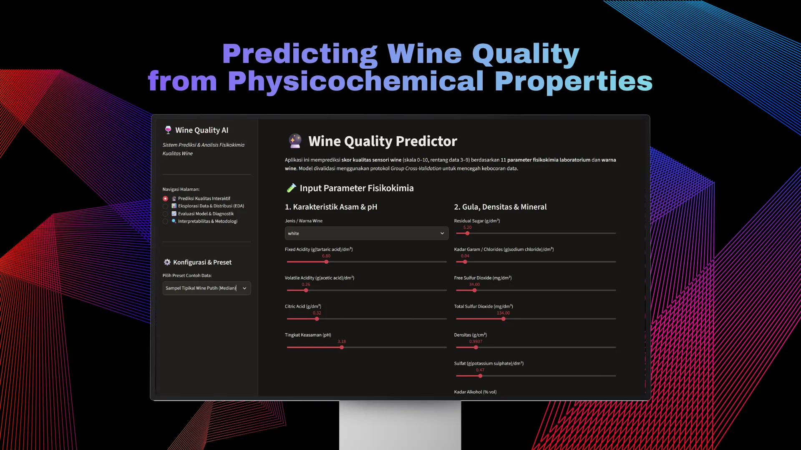
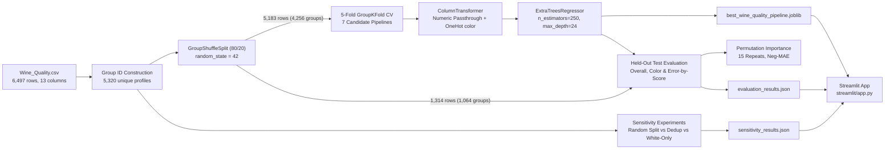
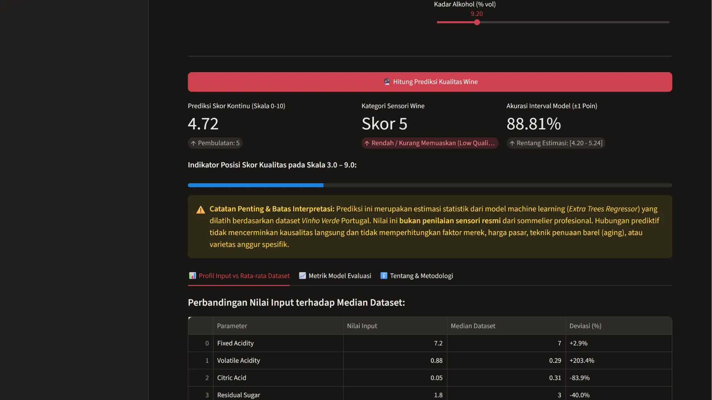
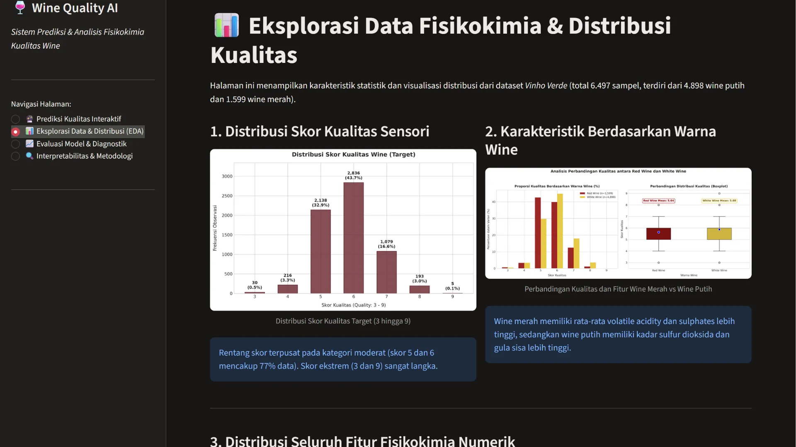
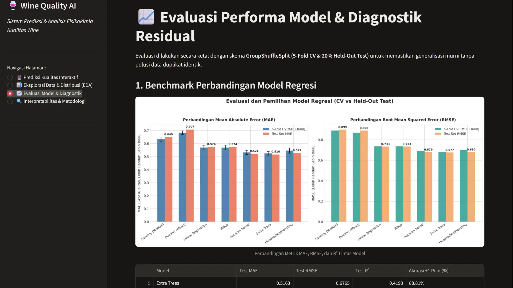
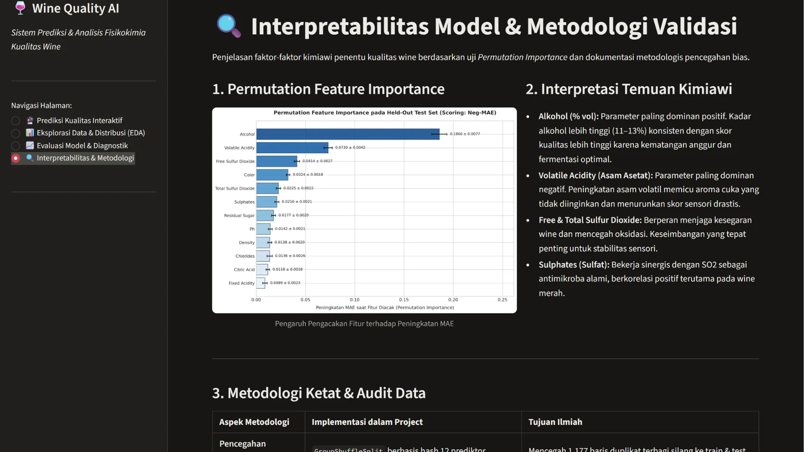
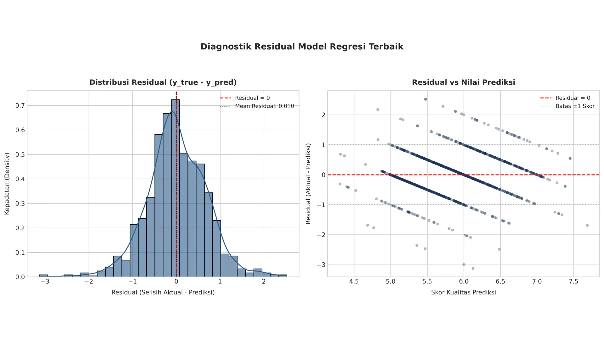
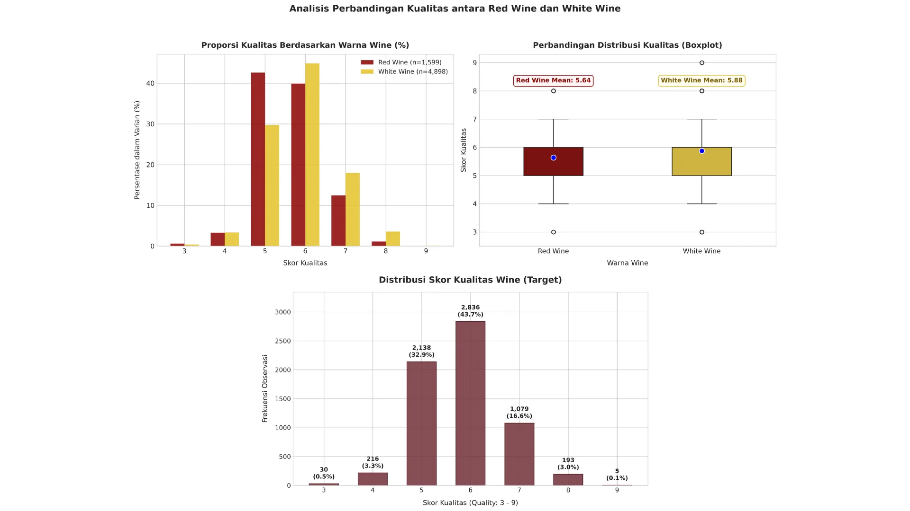
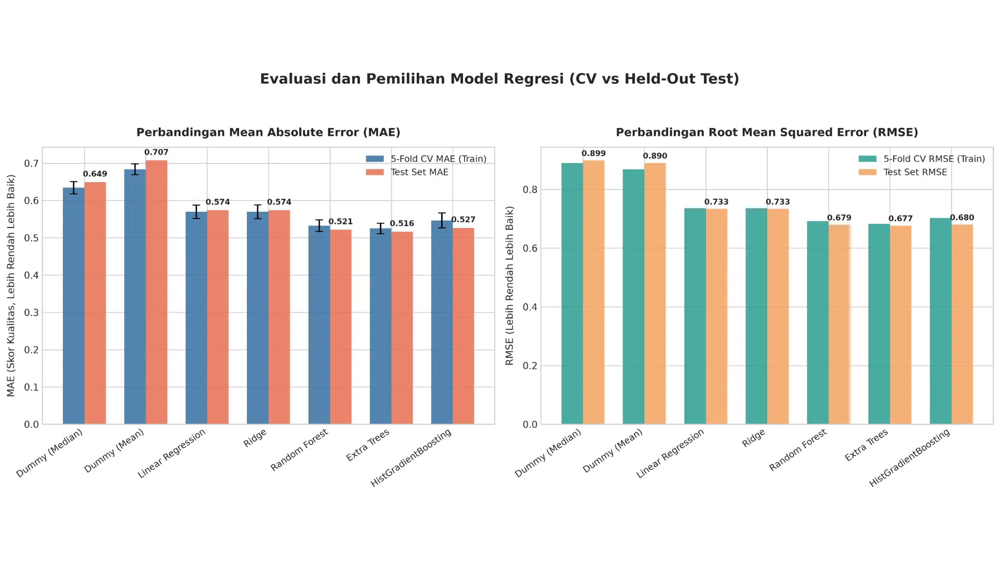

# Predicting Wine Quality from Physicochemical Properties




## Project Overview

Predicting Wine Quality from Physicochemical Properties is a supervised tabular regression project that estimates sensory wine quality scores from routine laboratory chemical measurements and wine color (`red` or `white`). Using the Portuguese *Vinho Verde* dataset of 6,497 wine samples, the project combines a strict leakage-free group splitting protocol, multi-model benchmarking, permutation feature importance diagnostics, sensitivity testing, and an interactive Streamlit analytics application built around a serialized `ExtraTreesRegressor` pipeline.

## Problem Statement & Objectives

In winemaking quality control, sensory evaluation by trained sommeliers and tasting panels is expensive, slow, and subject to inter-panelist variability and sensory fatigue. Objective physicochemical laboratory assays—such as alcohol content, acidity, residual sugar, sulfur dioxide levels, and density—are fast and repeatable, making automated quality estimation valuable as a pre-screening triage tool. At the same time, duplicate feature profiles present in combined wine datasets can cause severe data leakage under naive random splitting.

- Formulate sensory quality prediction (scores 3 to 9) as a supervised regression task to capture ordinal distance and continuous error magnitudes directly.
- Audit dataset integrity and prevent duplicate-profile data leakage by grouping identical predictor profiles before train/test partitioning and cross-validation.
- Benchmark baseline, linear, bagging, and gradient-boosted regressors under identical 5-fold `GroupKFold` and held-out test splits.
- Quantify chemical predictor importance and prediction error across quality tiers and wine colors without conflating correlation with causation.
- Provide a reproducible local pipeline and interactive Streamlit application for real-time prediction, exploratory visualization, and diagnostic review.

## Data & Input Sources

The project uses the Portuguese *Vinho Verde* wine dataset (`dataset/original/Wine_Quality.csv`) derived from Cortez et al. (2009) and UCI Machine Learning Repository ID 186, accompanied by `dataset/original/metadata.json`. While `metadata.json` describes the 4,898-row white-wine subset with 11 numeric attributes, the actual CSV file contains 6,497 observations across both variants—4,898 white wines (75.39%) and 1,599 red wines (24.61%)—with an explicit `color` attribute and zero missing values.

| Attribute | Description |
| :--- | :--- |
| Dataset / Input Source | Portuguese *Vinho Verde* Wine Quality Dataset (Cortez et al., 2009; UCI ID 186) |
| Source | [`dataset/original/Wine_Quality.csv`](dataset/original/Wine_Quality.csv) and [`dataset/original/metadata.json`](dataset/original/metadata.json) |
| Format | Tabular CSV (13 columns, UTF-8) |
| Samples / Records | 6,497 total rows (4,898 white wine, 1,599 red wine); 5,320 unique predictor profiles |
| Features / Input Shape | 12 predictor features: 11 continuous physicochemical float64 assays + 1 categorical `color` feature (`white` / `red`) |
| Target / Label | `quality` (int64 ordinal sensory median score; observed range 3–9, mean 5.82, std 0.87) |

## Data Preprocessing & Feature Engineering

Data auditing in [`src/data_audit.py`](src/data_audit.py) uncovered 1,177 exact duplicate rows (2,169 rows belonging to duplicate predictor groups across 5,320 unique profiles), with zero conflicting quality labels within any identical profile group. To eliminate memorization across train and test sets, preprocessing relies on predictor-profile grouping and model-specific `ColumnTransformer` pipelines fit strictly within training folds.

| Step / Component | Input | Transformation | Output |
| :--- | :--- | :--- | :--- |
| Group Identifier Construction | All 12 predictor columns | `df.groupby(features).ngroup()` | Integer `group_id` isolating identical profiles |
| Leakage-Free Partitioning | 6,497 rows + `group_id` | `GroupShuffleSplit(test_size=0.20, random_state=42)` | 5,183 train rows (4,256 groups) / 1,314 test rows (1,064 groups) |
| Linear Model Preprocessor | 11 numeric + `color` | `StandardScaler()` on numerics; `OneHotEncoder(drop="first", handle_unknown="ignore")` on `color` | Scaled feature matrix for OLS and Ridge |
| Tree Ensemble Preprocessor | 11 numeric + `color` | `"passthrough"` on numerics; `OneHotEncoder(drop=None, handle_unknown="ignore")` on `color` | Unscaled numeric + one-hot color features for tree models |

1. Load `Wine_Quality.csv` and verify column types, missingness (0 nulls), and physicochemical value bounds.
2. Assign a deterministic `group_id` across the 12 predictors (`fixed_acidity` through `alcohol`, plus `color`) excluding `quality`.
3. Partition the dataset into 80% training and 20% held-out test sets using `GroupShuffleSplit` with 0 overlapping groups.
4. Fit the `ColumnTransformer` inside each Scikit-learn `Pipeline` solely on training partitions during 5-fold `GroupKFold` validation and final fitting.

## Tech Stack

| Category | Technology | Purpose |
| :--- | :--- | :--- |
| Programming Language | Python | Core scripting, modeling, analysis, and dashboard runtime |
| ML & Preprocessing | Scikit-learn | `Pipeline`, `ColumnTransformer`, `GroupShuffleSplit`, `GroupKFold`, regressors, and permutation importance |
| Data Manipulation | Pandas | Tabular CSV ingestion, grouping, descriptive statistics, and aggregations |
| Numerical Computing | NumPy | Vectorized metric computations, jittering, and array operations |
| Visualization | Matplotlib | High-DPI publication-grade diagnostic, EDA, and model comparison charts |
| Statistical Plotting | Seaborn | Histograms with KDE, correlation heatmaps, and quality-stratified boxplots |
| Model Serialization | Joblib | Persistence and loading of the trained `ExtraTreesRegressor` pipeline |
| Interactive Dashboard | Streamlit | Four-page local web interface for real-time prediction and visual analytics |

## Machine Learning Approach

This project adopts a **Supervised Learning** regression formulation over structured tabular data. Regression was chosen over multi-class classification because the `quality` score is an ordered quantitative scale with meaningful metric intervals, allowing continuous predictions and direct error measurement in quality-score units.

| Attribute | Value |
| :--- | :--- |
| Learning Paradigm | Supervised Learning |
| Problem Domain | Enology & Physicochemical Quality Analytics |
| ML Task | Tabular Regression |
| Input | 11 continuous physicochemical features + 1 categorical wine color indicator |
| Target / Output | Continuous sensory `quality` score estimate (observed integer labels 3–9) |
| Validation Strategy | 80/20 `GroupShuffleSplit` holdout + 5-fold `GroupKFold` cross-validation on training set |

## Model Overview

Seven regression models were evaluated in [`src/modeling.py`](src/modeling.py), spanning constant baselines (`DummyRegressor` median and mean), linear estimators (`LinearRegression`, `Ridge`), and non-linear tree ensembles (`RandomForestRegressor`, `ExtraTreesRegressor`, `HistGradientBoostingRegressor`). **Extra Trees Regressor** was selected as the primary model because randomized threshold splitting reduces variance across skewed and collinear physicochemical features.

| Attribute | Details |
| :--- | :--- |
| Primary Model | Extra Trees Regressor (`ExtraTreesRegressor`) |
| Algorithm Family | Bagged Randomized Decision Tree Ensemble |
| Framework | Scikit-learn (`Pipeline` with `ColumnTransformer`) |
| Input Features | 11 numeric physicochemical measurements + one-hot encoded `color` (`red`, `white`) |
| Output | Continuous predicted sensory quality score |
| Pretrained Status | Trained from scratch on the 5,183-row training partition |
| Comparison Models | Dummy (Median), Dummy (Mean), Linear Regression, Ridge, Random Forest, HistGradientBoosting |

## ML Workflow

The end-to-end modeling workflow is modularized across four Python scripts under `src/` and an interactive application under `streamlit/`, documented in [`final_report.md`](final_report.md).

1. **Data Quality Audit & Split Verification** ([`src/data_audit.py`](src/data_audit.py)): Inspects schema, missing values, feature skewness, duplicate predictor profiles, target consistency across duplicate groups, and zero-overlap `GroupShuffleSplit` balance.
2. **Exploratory Data Analysis** ([`src/eda.py`](src/eda.py)): Generates five diagnostic figures covering target distribution, feature density curves, Pearson correlations, red vs. white wine comparisons, and feature-quality boxplots.
3. **Training, Cross-Validation, Evaluation & Diagnostics** ([`src/modeling.py`](src/modeling.py)): Runs 5-fold `GroupKFold` across all seven pipelines, trains the tuned `ExtraTreesRegressor`, evaluates held-out test performance overall and by wine color, computes permutation feature importance and per-score error bias, and persists artifacts to `models/`.
4. **Leakage & Subset Sensitivity Analysis** ([`src/sensitivity.py`](src/sensitivity.py)): Quantifies evaluation inflation under naive random splitting (27.6% leaked test rows), compares against deduplicated data (5,320 rows), and benchmarks a white-wine-only subset (4,898 rows).
5. **Interactive Inference & Analytics UI** ([`streamlit/app.py`](streamlit/app.py)): Loads `models/best_wine_quality_pipeline.joblib` and JSON evaluation summaries to provide real-time physicochemical scoring, preset comparisons, and embedded diagnostic views.

## ML Pipeline Architecture

The diagram below illustrates how raw tabular physicochemical records flow through duplicate-aware grouping, leakage-free splitting, preprocessing, cross-validation, sensitivity testing, artifact serialization, and local Streamlit inference.



## Model Training & Configuration

Training and evaluation are executed from scratch using fixed `RANDOM_SEED = 42` in [`src/modeling.py`](src/modeling.py). Linear models receive standardized numeric features and dropped-first one-hot color encoding, while tree ensembles receive unscaled numeric features and full one-hot color encoding.

| Configuration Parameter | Value |
| :--- | :--- |
| Primary Algorithm | `ExtraTreesRegressor` |
| `n_estimators` | `250` |
| `max_depth` | `24` |
| `min_samples_split` | `2` |
| `random_state` | `42` |
| `n_jobs` | `-1` |
| Train / Test Split | `GroupShuffleSplit(n_splits=1, test_size=0.20, random_state=42)` |
| Cross-Validation | 5-fold `GroupKFold` on 5,183 training rows |
| Primary Loss / Criterion | Squared Error (L2 default for `ExtraTreesRegressor`), evaluated by MAE, RMSE, $R^2$, and Within-$\pm 1$ Point Accuracy |

```python
best_et_params = {"n_estimators": 250, "max_depth": 24, "min_samples_split": 2}
best_pipeline = Pipeline([
    ("prep", preprocessor_tree),
    ("reg", ExtraTreesRegressor(**best_et_params, random_state=42, n_jobs=-1)),
])
best_pipeline.fit(X_train, y_train)
```

## Hyperparameter Tuning & Experiment Tracking

As documented in [`final_report.md`](final_report.md), Extra Trees hyperparameters were tuned on the training partition using 5-fold `GroupKFold` to minimize cross-validated MAE before fitting the final pipeline. No external experiment tracking server is used; all cross-validation, held-out test, color-stratified, error-by-quality, and sensitivity metrics are persisted deterministically in [`models/evaluation_results.json`](models/evaluation_results.json) and [`models/sensitivity_results.json`](models/sensitivity_results.json).

| Parameter / Artifact | Tested / Configured Values | Selected / Purpose |
| :--- | :--- | :--- |
| `n_estimators` | `[150, 200, 250]` | `250` |
| `max_depth` | `[16, 20, 24, None]` | `24` |
| `min_samples_split` | `[2, 3]` | `2` |
| CV Baseline Extra Trees (`200`, `20`, `3`) | MAE `0.5251 ± 0.0143` | Baseline CV benchmark in `evaluation_results.json` |
| Tuned Extra Trees (`250`, `24`, `2`) | Documented CV MAE `0.5242 ± 0.014` | Final model serialized to `best_wine_quality_pipeline.joblib` |
| Evaluation Metrics Log | JSON serialization | [`models/evaluation_results.json`](models/evaluation_results.json) |
| Sensitivity Metrics Log | JSON serialization | [`models/sensitivity_results.json`](models/sensitivity_results.json) |

## Model Comparison & Selection

All seven candidate pipelines were evaluated on the identical 5-fold `GroupKFold` training split and the 1,314-sample held-out test set. Extra Trees Regressor achieved the lowest MAE (`0.5163`), lowest RMSE (`0.6765`), and highest $R^2$ (`0.4198`) among all tested models while outperforming linear and gradient-boosted alternatives.

| Model | 5-Fold CV MAE | 5-Fold CV RMSE | 5-Fold CV $R^2$ | Test MAE | Test RMSE | Test $R^2$ | Test Within $\pm 1$ Pt |
| :--- | :---: | :---: | :---: | :---: | :---: | :---: | :---: |
| Dummy (Mean) | 0.6839 ± 0.0144 | 0.8688 ± 0.0201 | -0.0001 | 0.7074 | 0.8900 | -0.0041 | 73.59% |
| Dummy (Median) | 0.6342 ± 0.0167 | 0.8899 ± 0.0209 | -0.0495 | 0.6492 | 0.8986 | -0.0235 | 93.00% |
| Linear Regression | 0.5697 ± 0.0183 | 0.7358 ± 0.0227 | 0.2823 | 0.5739 | 0.7335 | 0.3180 | 85.69% |
| Ridge ($\alpha=10.0$) | 0.5696 ± 0.0184 | 0.7356 ± 0.0228 | 0.2825 | 0.5739 | 0.7335 | 0.3181 | 85.69% |
| HistGradientBoosting | 0.5466 ± 0.0201 | 0.7026 ± 0.0240 | 0.3458 | 0.5267 | 0.6801 | 0.4137 | 87.37% |
| Random Forest | 0.5324 ± 0.0154 | 0.6920 ± 0.0237 | 0.3654 | 0.5215 | 0.6795 | 0.4148 | 87.98% |
| **Extra Trees (Tuned)** | **0.5251 ± 0.0143** | **0.6829 ± 0.0213** | **0.3821** | **0.5163** | **0.6765** | **0.4198** | **88.81%** |

*Note: `Dummy (Median)` achieves 93.00% within-1 accuracy trivially because 93.17% of dataset samples fall within scores 5–7 around median 6, despite negative $R^2$ and much higher MAE/RMSE.*

## Model Artifacts & Checkpoints

All trained pipeline artifacts and evaluation outputs are generated locally by the project scripts and stored under `models/`.

| Artifact | Format | Purpose | Location |
| :--- | :--- | :--- | :--- |
| `best_wine_quality_pipeline.joblib` | Joblib | Serialized Scikit-learn `Pipeline` (`ColumnTransformer` + tuned `ExtraTreesRegressor`) used by Streamlit | [`models/best_wine_quality_pipeline.joblib`](models/best_wine_quality_pipeline.joblib) |
| `evaluation_results.json` | JSON | Stored 5-fold CV metrics, held-out test metrics, color breakdown, and per-quality error diagnostics | [`models/evaluation_results.json`](models/evaluation_results.json) |
| `sensitivity_results.json` | JSON | Stored leakage (`GroupShuffleSplit` vs. `train_test_split`), deduplication, and white-only benchmarks | [`models/sensitivity_results.json`](models/sensitivity_results.json) |

## Model Evaluation & Results

On the independent 1,314-sample held-out test set (1,064 unique predictor groups), the tuned Extra Trees Regressor predicts wine quality with an average error of roughly half a sensory score point and keeps nearly 89% of predictions within $\pm 1.0$ point. Performance remains consistent across both red and white wines, while sensitivity experiments confirm that naive random splitting leaks 27.6% of test rows from identical training profiles and artificially depresses MAE from `0.5180` to `0.4016`.

| Evaluation Segment | Sample Count ($n$) | MAE | RMSE | $R^2$ | Within $\pm 1$ Pt Acc |
| :--- | :---: | :---: | :---: | :---: | :---: |
| Overall Held-Out Test Set (Tuned Extra Trees) | 1,314 | 0.5163 | 0.6765 | 0.4198 | 88.81% |
| Red Wine Test Subset | 290 | 0.5069 | 0.6554 | 0.3246 | 88.62% |
| White Wine Test Subset | 1,024 | 0.5190 | 0.6824 | 0.4326 | 88.87% |
| Sensitivity: Group Split Baseline (No Leakage) | 1,314 | 0.5180 | 0.6769 | 0.4191 | 88.28% |
| Sensitivity: Naive Random Split (359 / 27.6% Leaked) | 1,300 | 0.4016 | 0.5880 | 0.5319 | 90.08% |
| Sensitivity: Deduplicated Dataset | 5,320 (total) | 0.5106 | 0.6639 | 0.4137 | 87.97% |
| Sensitivity: White-Only Subset (Group Split) | 4,898 (total) | 0.5202 | 0.6724 | 0.3922 | 87.50% |

- **Strong Core Accuracy, Extreme-Class Compression:** Per-quality breakdown in `evaluation_results.json` shows low errors on majority scores 5 (`MAE = 0.4675`, $n = 408$), 6 (`MAE = 0.3581`, $n = 559$), and 7 (`MAE = 0.6132`, $n = 255$), whereas rare extreme scores 3 (`MAE = 2.4011`, bias `+2.4011`, $n = 6$) and 8 (`MAE = 1.4771`, bias `-1.4771`, $n = 41$) exhibit regression-to-the-mean compression.
- **Unexplained Variance Drivers:** Approximately 58% of score variance remains unexplained because sensory perception depends on human panelist subjectivity and unmeasured grape cultivar, vintage, phenolic, and oak-aging compounds.
- **Regional Scope Limitation:** All samples originate from northern Portugal's *Vinho Verde* appellation, limiting direct generalization to other wine regions without recalibration.

## Model Explainability & Interpretability

Feature contributions were quantified directly on the held-out test set in [`src/modeling.py`](src/modeling.py) using `sklearn.inspection.permutation_importance` with `scoring="neg_mean_absolute_error"` and `n_repeats=15`. Alcohol concentration, volatile acidity, free sulfur dioxide, and wine color emerge as the strongest predictive signals, reflecting enological maturation, acetic spoilage, oxidation control, and variant baselines rather than direct causal interventions.

| Rank | Feature | Mean MAE Increase | Std Dev | Dominant Relationship |
| :---: | :--- | :---: | :---: | :--- |
| 1 | `alcohol` | 0.1860 | ± 0.0077 | Strong positive association with quality ($r = +0.44$) |
| 2 | `volatile_acidity` | 0.0730 | ± 0.0042 | Strong negative association due to acetic/vinegar notes ($r = -0.27$) |
| 3 | `free_sulfur_dioxide` | 0.0414 | ± 0.0027 | Non-linear stabilization optimum against oxidation |
| 4 | `color` | 0.0324 | ± 0.0018 | Interactive baseline difference between red and white matrices |
| 5 | `total_sulfur_dioxide` | 0.0225 | ± 0.0022 | Negative impact at excessive concentration levels |
| 6 | `sulphates` | 0.0210 | ± 0.0021 | Moderate positive antimicrobial/antioxidant contribution |
| 7 | `residual_sugar` | 0.0177 | ± 0.0020 | Non-linear contribution dependent on acidity balance |
| 8 | `pH` | 0.0142 | ± 0.0021 | Moderate acidity equilibrium effect |
| 9 | `density` | 0.0138 | ± 0.0020 | Moderate negative correlation driven by alcohol/sugar balance ($r = -0.31$) |
| 10 | `chlorides` | 0.0136 | ± 0.0026 | Negative association with elevated salinity ($r = -0.20$) |
| 11 | `citric_acid` | 0.0118 | ± 0.0018 | Weak positive freshness contribution |
| 12 | `fixed_acidity` | 0.0089 | ± 0.0023 | Weak standalone predictive impact |

## Results Visualization & Preview

### 1. Interactive Prediction Input Interface (Low-Quality Red Wine Preset)

The Streamlit prediction interface lets users configure wine color and 11 laboratory physicochemical sliders across acidity, pH, sugar, density, sulfur dioxide, and alcohol parameters. Here, the low-quality red wine preset illustrates elevated volatile acidity (`0.88 g/dm³`) paired with lower alcohol (`9.20% vol`).

### 2. Prediction Output & Input Profile vs. Dataset Median Tab

For the low-quality red wine preset, the Extra Trees Regressor outputs a continuous score of `4.72` (rounded `Score 5`, estimated interval `[4.20 - 5.24]`) alongside a sensory interpretation disclaimer. The active tab compares every user-entered laboratory value against dataset medians, highlighting a `+203.4%` volatile acidity deviation.

### 3. Held-Out Evaluation Metrics Tab

The Evaluation Metrics tab surfaces held-out test benchmarks for the selected Extra Trees Regressor directly inside the prediction workspace, reporting Test MAE (`0.516`), Test RMSE (`0.676`), Within $\pm 1$ Point Accuracy (`88.81%`), and Test $R^2$ (`0.420`) across 1,314 independent observations.

### 4. About & Validation Methodology Tab

The Methodology tab documents the serialized model hyperparameters (`250` estimators, max depth `24`, min samples split `2`), the `GroupShuffleSplit` protocol isolating 1,177 duplicate rows, top informative physicochemical predictors, and the UCI *Vinho Verde* dataset citation.

### 5. Exploratory Data Analysis Dashboard Page

The dedicated EDA page presents target quality distribution and red-versus-white wine comparison panels side by side. It highlights that scores 5 and 6 account for roughly 77% of observations while extreme scores 3 and 9 remain rare.

### 6. Model Evaluation & Benchmark Diagnostics Page

The Model Evaluation page aggregates cross-validation versus held-out test MAE and RMSE charts alongside a sortable benchmark table ranking all seven regression pipelines.

### 7. Model Interpretability & Audit Methodology Page

The Interpretability page pairs the permutation feature importance ranking on the held-out test set with domain-level chemical interpretations and a structured table summarizing leakage-prevention and validation safeguards.

### 8. Actual vs. Predicted Scatter & Per-Quality Error Breakdown

The left panel plots actual quality scores against Extra Trees predictions, showing 88.8% of test observations falling within the $\pm 1$-point tolerance corridor (`MAE = 0.516`, `RMSE = 0.677`, `R² = 0.420`). The right panel exposes regression-to-the-mean compression: majority scores 5 (`MAE = 0.47`), 6 (`MAE = 0.36`), and 7 (`MAE = 0.61`) are predicted accurately, while rare extremes 3 (`+2.40` bias) and 8 (`-1.48` bias) incur larger errors.

### 9. Residual Distribution & Residual vs. Predicted Diagnostics

The residual histogram (left) exhibits an approximately symmetric, zero-centered distribution (`mean residual = 0.010`), confirming unbiased central predictions. The residual-versus-predicted scatter plot (right) shows most errors contained within $\pm 1.0$ score units, with diagonal bands reflecting the discrete integer target scale (3–9).

### 10. Physicochemical Feature Density Distributions

This 11-panel histogram and KDE grid compares mean and median positions across all laboratory attributes in the 6,497-row dataset. It highlights heavy positive skew in `chlorides` (`5.40`), `sulphates` (`1.80`), and `fixed_acidity` (`1.72`), motivating non-linear tree ensembles.

### 11. Key Physicochemical Features vs. Quality Score Boxplots

Stratified boxplots reveal a strong monotonic increase in median `alcohol` from low- to high-quality wines alongside decreasing `volatile_acidity` and `density`. These trends align with both Pearson correlation rankings and permutation importance findings.

### 12. Permutation Feature Importance on Held-Out Test Set

Evaluated across 15 random permutations using negative MAE scoring, `alcohol` produces the largest error degradation (`0.1860 ± 0.0077`), followed by `volatile_acidity` (`0.0730 ± 0.0042`), `free_sulfur_dioxide` (`0.0414 ± 0.0027`), and `color` (`0.0324 ± 0.0018`).

### 13. Target Quality Distribution & Variant Comparison

Combined exploratory plots contrast quality score proportions between red ($n = 1,599$, mean `5.64`) and white ($n = 4,898$, mean `5.88`) wines above the overall class distribution across all 6,497 observations, showing concentration in scores 5 (`32.9%`), 6 (`43.7%`), and 7 (`16.6%`).

### 14. Regression Model Comparison (5-Fold GroupKFold CV vs. Test Set)

Paired bar charts compare 5-fold cross-validation and held-out test MAE (left) and RMSE (right) across all seven models. Tree ensembles outperform dummy baselines and linear models, with Extra Trees achieving the lowest test MAE (`0.516`) and RMSE (`0.677`).

### 15. Pearson Correlation Matrix Heatmap

The lower-triangular Pearson heatmap orders features by correlation with `quality`, confirming `alcohol` as the strongest positive correlate (`+0.44`) and `density` (`-0.31`) and `volatile_acidity` (`-0.27`) as primary negative correlates, alongside collinearity between `density` and `alcohol` (`-0.69`) and between `free` and `total_sulfur_dioxide` (`+0.72`).

## Prerequisites

- **Operating System:** Windows, macOS, or Linux (CPU execution supported; no GPU/CUDA hardware required)
- **Python Runtime:** Python 3.10+ recommended (verified in `final_report.md` on Python 3.15.1)
- **Package Manager:** `pip`
- **Python Dependencies (`requirements.txt`):** `pandas>=2.0.0, <=3.1.1`, `numpy>=1.24.0, <=2.5.4`, `scikit-learn>=1.3.0, <=1.9.1`, `matplotlib>=3.7.0, <=3.11.2`, `seaborn>=0.12.0, <=0.13.2`, `joblib>=1.3.0, <=1.6.0`, `streamlit>=1.30.0, <=1.67.0`
- **Local Artifacts for Inference Only:** `models/best_wine_quality_pipeline.joblib`, `models/evaluation_results.json`, `models/sensitivity_results.json`, and `figures/*.png` (all included in the repository)

## Installation & Setup

1. **Clone the repository:**
   ```bash
   git clone https://github.com/weztcy/Predicting-Wine-Quality-from-Physicochemical-Properties.git
   cd "Predicting-Wine-Quality-from-Physicochemical-Properties"
   ```
2. **Create and activate a Python virtual environment:**
   ```bash
   python -m venv .venv
   # Windows (PowerShell):
   .venv\Scripts\Activate.ps1
   # macOS / Linux:
   source .venv/bin/activate
   ```
3. **Install required dependencies:**
   ```bash
   pip install -r requirements.txt
   ```

## Usage & Execution

You can launch the pre-trained Streamlit application immediately from the repository root, or re-run the data audit, EDA, modeling, and sensitivity scripts after aligning the dataset path expected by `src/`.

1. **Launch the interactive Streamlit dashboard (uses pre-trained artifacts in `models/` and `figures/`):**
   ```bash
   python -m streamlit run streamlit/app.py
   ```
2. **Note on dataset path for training/audit scripts:** The scripts in `src/` default to `dataset/Wine_Quality.csv` (and `dataset/metadata.json`), whereas the raw data files in this repository reside under [`dataset/original/Wine_Quality.csv`](dataset/original/Wine_Quality.csv) and [`dataset/original/metadata.json`](dataset/original/metadata.json). To re-run the `src/` scripts from the repository root without editing code, copy `dataset/original/Wine_Quality.csv` and `dataset/original/metadata.json` into `dataset/` first (or call `run_audit(...)` with explicit paths).
3. **Run individual pipeline stages:**
   ```bash
   python src/data_audit.py
   python src/eda.py
   python src/modeling.py
   python src/sensitivity.py
   ```

## Reproducibility & Execution

All modeling, cross-validation, permutation importance, and sensitivity experiments are deterministic with `RANDOM_SEED = 42` across `np.random.seed`, `GroupShuffleSplit`, `ExtraTreesRegressor`, `RandomForestRegressor`, `HistGradientBoostingRegressor`, `Ridge`, and `permutation_importance`. Inference reproducibility only requires loading `models/best_wine_quality_pipeline.joblib` with compatible `scikit-learn` and `joblib` versions, whereas training reproduction requires regenerating figures and model artifacts from `Wine_Quality.csv`.

1. Ensure the exact dependency ranges in [`requirements.txt`](requirements.txt) are installed (experiments in [`final_report.md`](final_report.md) were recorded under Python 3.15.1, `pandas==3.1.1`, `numpy==2.5.4`, `scikit-learn==1.9.1`, `matplotlib==3.11.2`, `seaborn==0.13.2`, `joblib==1.6.0`, `streamlit==1.67.0`).
2. Ensure `dataset/Wine_Quality.csv` is accessible at `dataset/Wine_Quality.csv` (copied from `dataset/original/Wine_Quality.csv`).
3. Execute the full pipeline sequentially from the repository root:
   ```bash
   python src/data_audit.py && python src/eda.py && python src/modeling.py && python src/sensitivity.py
   ```
4. Verify regenerated metrics in `models/evaluation_results.json` and `models/sensitivity_results.json`, noting minor floating-point variations may occur across different `scikit-learn` or `numpy` patch releases (`n_jobs=-1` tree fitting remains seed-controlled via `random_state=42`).

## Contributing

Contributions to improve feature engineering, calibration for extreme quality tiers, or visualization clarity are welcome. Please follow this standard workflow:

1. Fork the repository.
2. Create a branch for the change.
3. Make the changes.
4. Run relevant checks or tests when available.
5. Commit and push the branch.
6. Open a pull request with a clear explanation.

## License

This project is licensed under the MIT License.
See the [LICENSE](LICENSE) file for details.

## Author & Contact

**Yohanes Dimas Pratama**

- GitHub: [github.com/weztcy](https://github.com/weztcy)
- Portfolio: [yohanesdimas.com](https://yohanesdimas.com)
- LinkedIn: [linkedin.com/in/yohanes-dimas](https://www.linkedin.com/in/yohanes-dimas)
