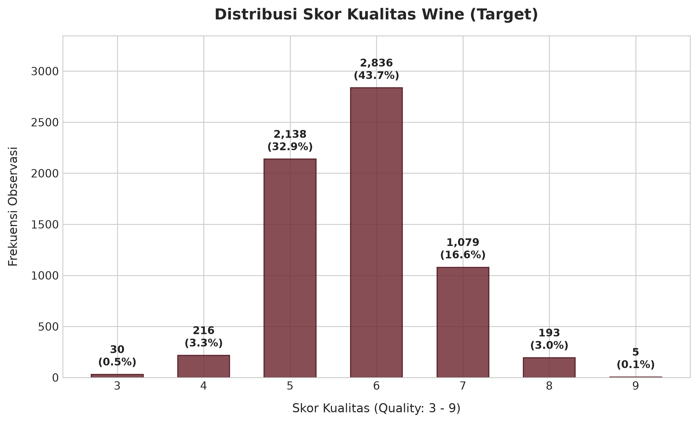
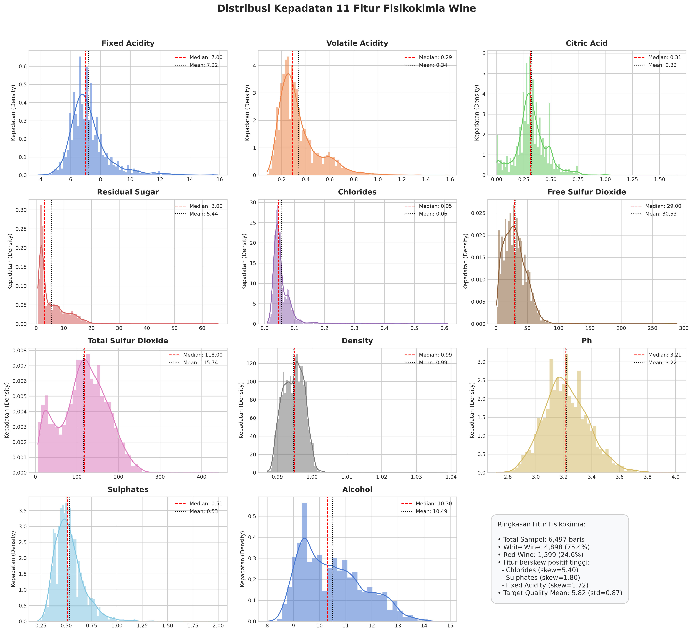
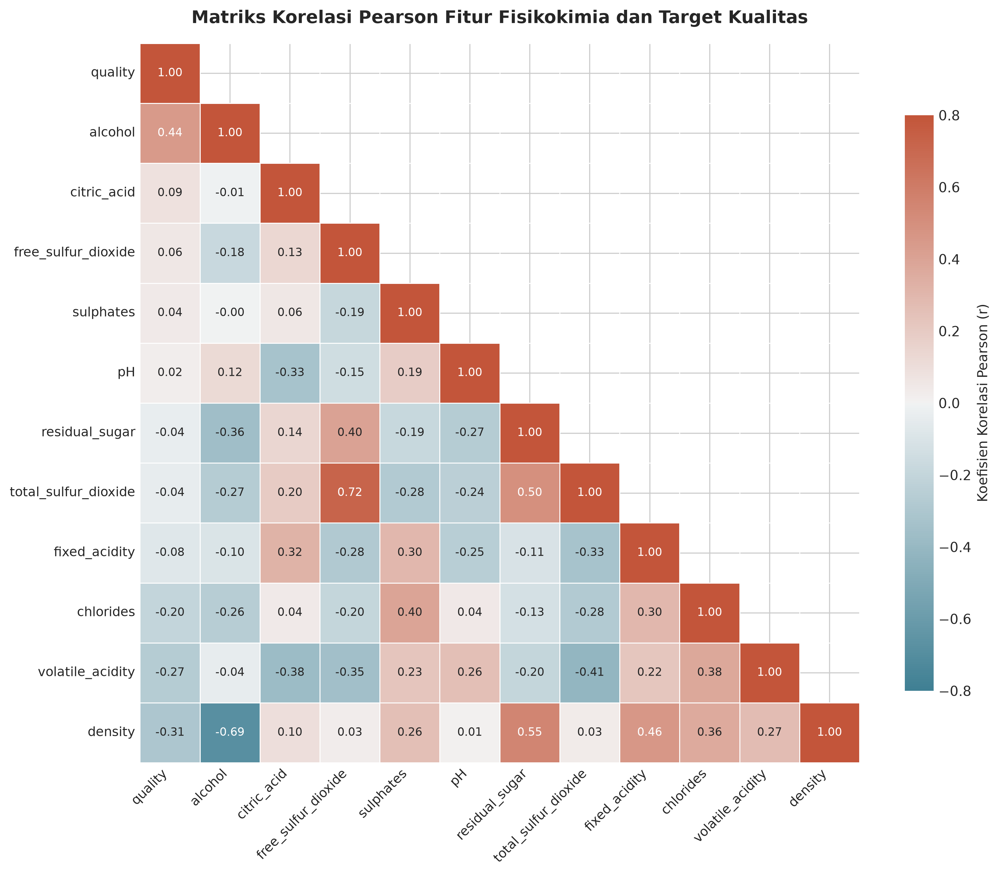
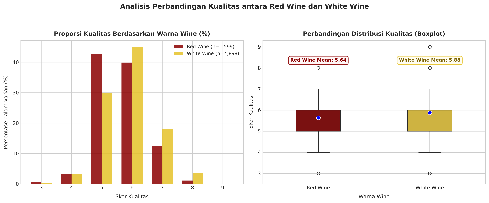
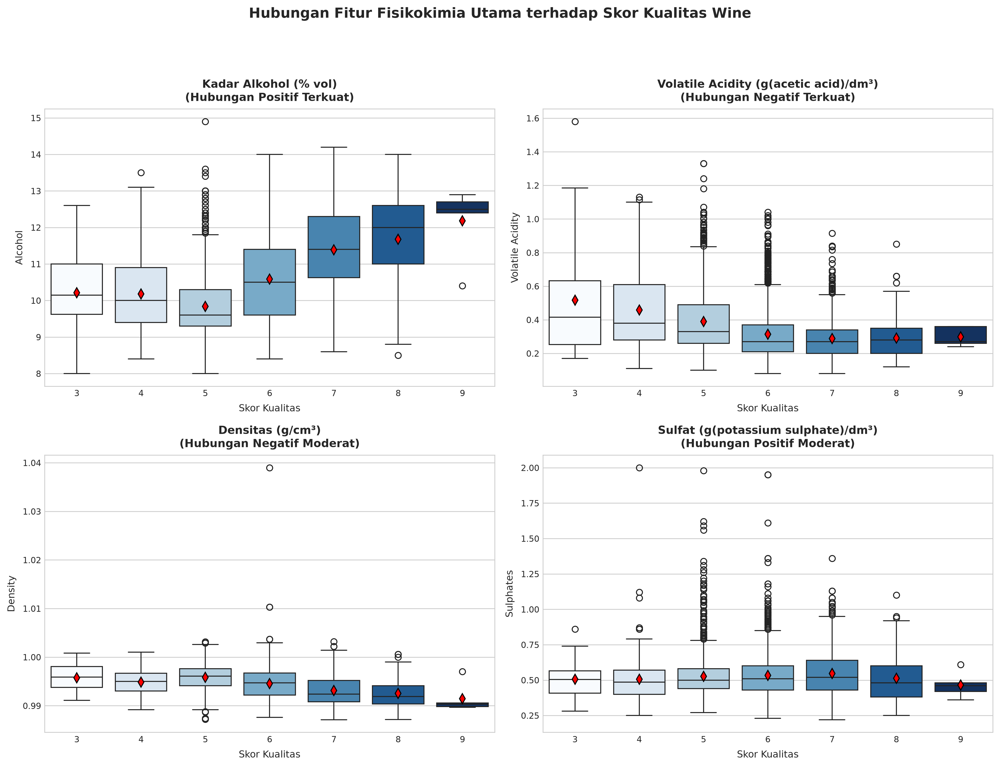
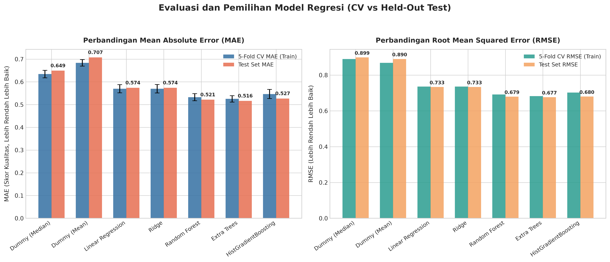
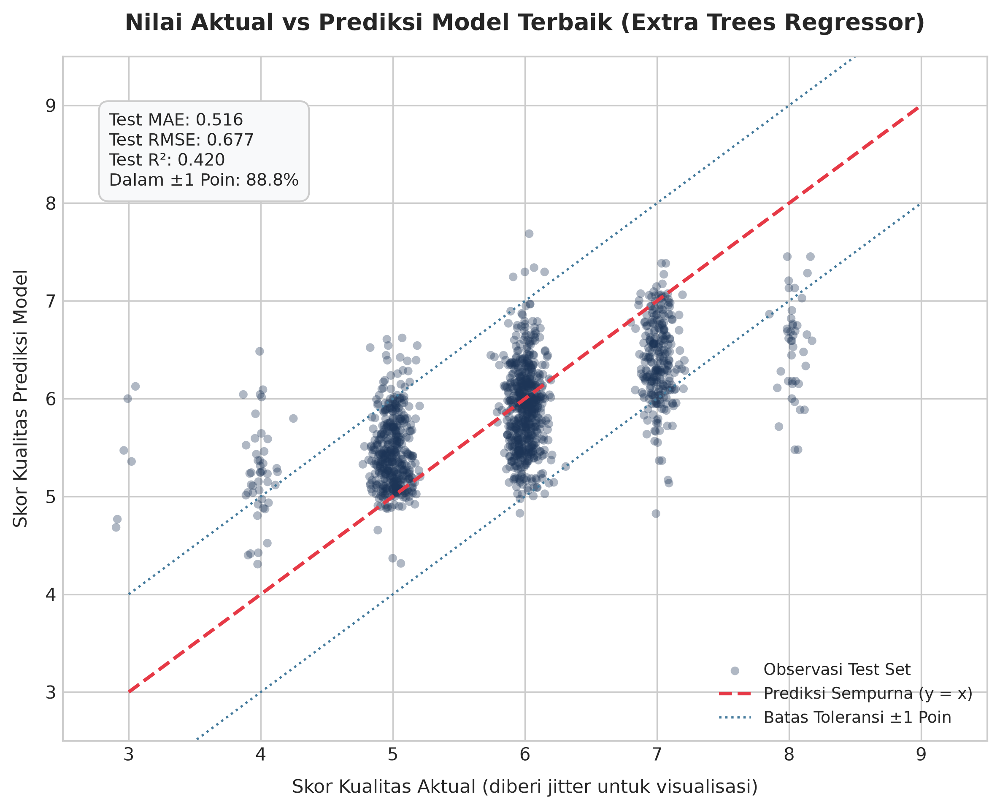
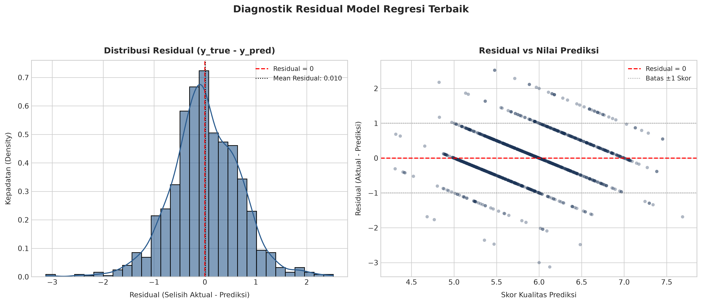
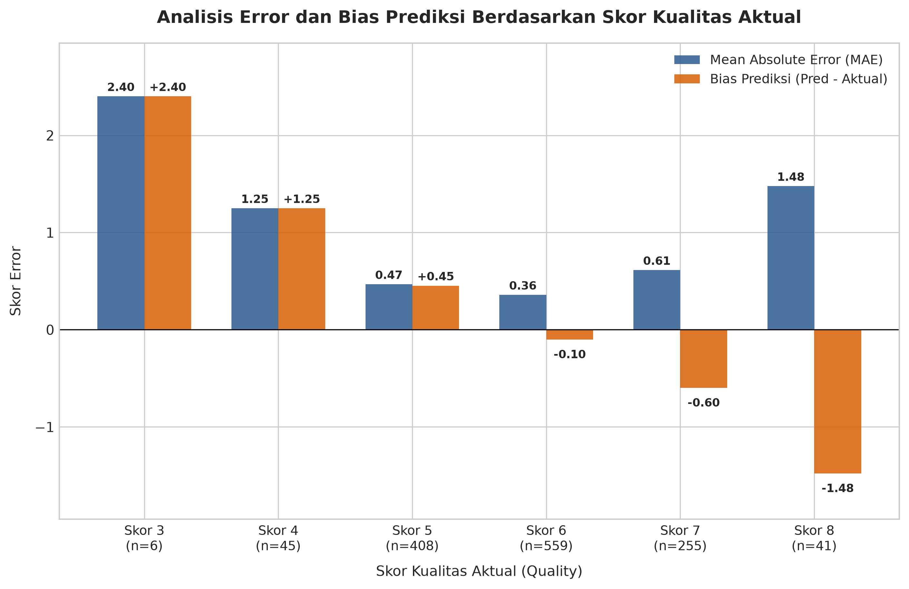
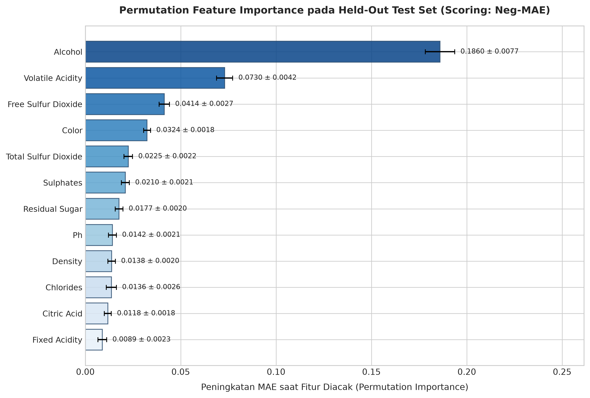

# Laporan Akhir: Predicting Wine Quality from Physicochemical Properties

---

## 1. Judul Project

**Predicting Wine Quality from Physicochemical Properties**  
*Pemodelan Regresi Berbasis Pembelajaran Mesin untuk Prediksi Skor Kualitas Sensori Wine Berdasarkan Karakteristik Fisikokimia dan Warna Wine*

---

## 2. Ringkasan Eksekutif

Laporan ini menyajikan pengembangan dan evaluasi pipeline pembelajaran mesin tersupervisi (*supervised regression*) untuk memprediksi skor kualitas sensori wine berdasarkan 11 karakteristik fisikokimia laboratorium dan warna wine (*red* vs *white*). Dataset aktual terdiri atas **6.497 observasi** yang bersumber dari varian wine *Vinho Verde* asal Portugal utara (Cortez et al., 2009).

### Pendekatan Metodologis
- **Formulasi Masalah:** Regresi dipilih karena target `quality` merupakan variabel kuantitatif berurutan (*ordinal score*) dari rentang 3 hingga 9 yang memiliki jarak metrik bermakna. Pendekatan regresi memfasilitasi estimasi kontinu sekaligus penghitungan deviasi kesalahan secara langsung.
- **Audit Data & Pencegahan Kebocoran Data (*Data Leakage*):** Pemeriksaan mendalam mengidentifikasi **1.177 baris duplikat identik** (total 2.169 baris dalam kelompok duplikat, merepresentasikan 5.320 profil unik). Alih-alih menghapus observasi secara naif, dibentuk identifier kelompok (*group identifier*) berdasarkan kombinasi seluruh fitur prediktor. Pemisahan data dilakukan melalui `GroupShuffleSplit` (80% *training*, 20% *held-out testing*) sehingga tidak ada profil prediktor identik yang terdistribusi lintas partisi.
- **Validasi Silang Bebas Bocor:** Seluruh pemilihan algoritma dan penyelarasan hiperparameter dilakukan semata-mata pada data pelatihan menggunakan 5-fold `GroupKFold`.
- **Eksperimen Algoritma:** Tujuh pendekatan dievaluasi: *Dummy Regressor (Median & Mean)* sebagai baseline, *Linear Regression*, *Ridge Regression*, *Random Forest Regressor*, *Extra Trees Regressor*, dan *HistGradientBoostingRegressor*.

### Hasil Utama
- **Model Terbaik:** **Extra Trees Regressor** (*tuned* dengan 250 pohon, kedalaman maksimum 24, dan *min samples split* 2) mencapai performa tertinggi pada *held-out test set* (1.314 sampel independen) dengan:
  - **Mean Absolute Error (MAE): 0.5163** (rata-rata kesalahan prediksi sekitar 0.52 poin kualitas).
  - **Root Mean Squared Error (RMSE): 0.6765**.
  - **Koefisien Determinasi ($R^2$): 0.4198**.
  - **Within-One-Point Accuracy: 88.81%** (hampir 89% sampel diprediksi dengan selisih absolut $\le 1.0$ skor kualitas).
- **Faktor Prediktif Utama:** Berdasarkan analisis *Permutation Feature Importance* pada *test set*, fitur paling informatif adalah **Alcohol** (penurunan MAE saat diacak sebesar 0.1860), disusul oleh **Volatile Acidity** (0.0730), **Free Sulfur Dioxide** (0.0414), dan **Color** (0.0324).
- **Sensitivitas Kebocoran Data:** Evaluasi perbandingan menunjukkan bahwa partisi acak naif (*Random Split*) menghasilkan kebocoran data duplikat sebesar 27.6% ke dalam data uji, menghasilkan estimasi performa optimis semu (MAE 0.4016 vs aktual 0.5180). Hal ini membuktikan pentingnya pemisahan berbasis kelompok (*group split*).

---

## 3. Latar Belakang dan Tujuan

Dalam industri pembuat wine (*winemaking*), evaluasi kualitas produk tradisional mengandalkan uji organoleptik oleh panel sommelier atau ahli sensori terlatih. Walaupun merupakan tolok ukur standar mutu pasar, pengujian sensori manual memiliki kelemahan signifikan: memakan waktu lama, membutuhkan biaya tinggi, memiliki subjektivitas antarpanelis, dan rentan terhadap kelelahan sensorik (*sensory fatigue*).

Sebagai pelengkap pengujian sensori, parameter fisikokimia—seperti konsentrasi alkohol, keasaman (*acidity*), kadar gula sisa, sulfur dioksida, dan densitas—dapat diukur di laboratorium kimia secara objektif, terstandar, dan berulang.

### Tujuan Project
Project ini bertujuan untuk:
1. Membangun pipeline pemodelan regresi yang memetakan sifat-sifat fisikokimia serta warna wine ke dalam estimasi skor kualitas sensori.
2. Menerapkan metodologi evaluasi data yang ketat dan bebas kebocoran data (*zero data leakage*), khususnya dalam penanganan duplikasi data observasi.
3. Menjelaskan faktor prediktif kimiawi yang paling informatif terhadap kualitas wine.
4. Menyediakan antarmuka demonstrasi interaktif berbasis Streamlit beserta dokumentasi kode yang dapat direproduksi secara utuh.

### Pertanyaan Project
1. *Seberapa baik karakteristik fisikokimia dan warna wine memprediksi skor quality?*
2. *Model regresi mana yang memberikan performa terbaik pada data yang tidak digunakan saat pelatihan?*
3. *Seberapa besar rata-rata kesalahan prediksi dalam satuan skor kualitas?*
4. *Fitur apa yang paling informatif bagi prediksi model?*
5. *Apakah performa model berbeda antara red wine dan white wine?*
6. *Apakah penanganan duplikasi dan pemisahan data yang mencegah data identik masuk ke train dan test memengaruhi hasil evaluasi?*

---

## 4. Deskripsi Dataset

### 4.1 Sumber Data dan Struktur CSV Aktual
Dataset yang digunakan dalam penelitian ini disimpan dalam `dataset/Wine_Quality.csv` dengan total **6.497 baris dan 13 kolom**.

Tabel berikut merangkum daftar seluruh kolom, tipe data, dan deskripsi teknisnya:

| No | Nama Kolom | Tipe Data | Deskripsi Teknis | Satuan / Rentang |
|:---|:---|:---|:---|:---|
| 1 | `fixed_acidity` | Float64 | Asam non-volatil (terutama asam tartarat) | $\text{g(tartaric acid)/dm}^3$ [3.80 - 15.90] |
| 2 | `volatile_acidity` | Float64 | Asam volatil (terutama asam asetat, pemicu aroma cuka) | $\text{g(acetic acid)/dm}^3$ [0.08 - 1.58] |
| 3 | `citric_acid` | Float64 | Asam sitrat (penambah kesegaran aroma) | $\text{g/dm}^3$ [0.00 - 1.66] |
| 4 | `residual_sugar` | Float64 | Gula sisa setelah fermentasi berhenti | $\text{g/dm}^3$ [0.60 - 65.80] |
| 5 | `chlorides` | Float64 | Kadar garam dalam wine | $\text{g(sodium chloride)/dm}^3$ [0.009 - 0.611] |
| 6 | `free_sulfur_dioxide` | Float64 | Bentuk bebas $\text{SO}_2$ (pencegah oksidasi & mikroba) | $\text{mg/dm}^3$ [1.0 - 289.0] |
| 7 | `total_sulfur_dioxide` | Float64 | Total $\text{SO}_2$ (bentuk bebas + terikat) | $\text{mg/dm}^3$ [6.0 - 440.0] |
| 8 | `density` | Float64 | Massa jenis wine | $\text{g/cm}^3$ [0.98711 - 1.03898] |
| 9 | `pH` | Float64 | Derajat keasaman wine | Skala pH [2.72 - 4.01] |
| 10 | `sulphates` | Float64 | Kalium sulfat (aditif anti-mikroba/anti-oksidan) | $\text{g(potassium sulphate)/dm}^3$ [0.22 - 2.00] |
| 11 | `alcohol` | Float64 | Persentase volume alkohol | % vol [8.00 - 14.90] |
| 12 | `color` | String (Object) | Kategori warna wine (`white` atau `red`) | Kategorikal (2 kelas) |
| 13 | `quality` | Int64 | **Target regresi**: Skor sensori median evaluator | Integer terurut [3 - 9] |

### 4.2 Analisis Ketidaksesuaian Metadata (*Metadata Discrepancy*)
Terdapat perbedaan signifikan antara `metadata.json` dan file data `Wine_Quality.csv` yang disediakan:
- **`metadata.json`**: Menyebutkan jumlah sampel sebanyak 4.898 observasi dengan 11 fitur numerik, yang merujuk secara spesifik pada varian *white wine* dari koleksi UCI Wine Quality.
- **`Wine_Quality.csv` aktual**: Memiliki 6.497 observasi dan memuat fitur tambahan `color`. Komposisi observasi adalah **4.898 white wine (75.39%)** dan **1.599 red wine (24.61%)**.

**Keputusan Metodologis:**  
Sesuai arahan pada `TASK.md`, data aktual CSV diperlakukan sebagai *ground truth* eksperimen. Fitur `color` dan sampel *red wine* tidak dihapus atau dimanipulasi secara diam-diam. Sebaliknya, `color` diintegrasikan secara formal ke dalam pipeline pemodelan melalui *one-hot encoding*. Untuk melengkapi komparabilitas terhadap metadata, dilakukan pula analisis sensitivitas terpisah pada subset *white-only*.

---

## 5. Data Audit dan Preprocessing

### 5.1 Pemeriksaan Kualitas Data
Eksekusi script `src/data_audit.py` mengonfirmasi hal-hal berikut:
1. **Missing Value:** Tidak ditemukan satupun nilai kosong (*missing values*) pada ke-13 kolom (0 nilai *null*).
2. **Inkonsistensi Tipe Data:** Semua fitur numerik tersimpan sebagai *float64*, target tersimpan sebagai *int64*, dan `color` tersimpan konsisten sebagai *string/object*.
3. **Pemeriksaan Nilai Ekstrem:** Rentang nilai secara teknis masuk akal bagi parameter oenologi:
   - Densitas wine berada di sekitar air ($0.987 - 1.039 \text{ g/cm}^3$).
   - pH berkisar antara 2.72 dan 4.01 (rentang wajar keasaman minuman fermentasi buah anggur).
   - Fitur `chlorides`, `sulphates`, dan `fixed_acidity` memiliki ekor distribusi kanan yang panjang (*positive skew*), namun tetap mencerminkan variabilitas batch riil.

Tabel statistik deskriptif ringkas:

| Fitur | Mean | Std | Min | 25% | Median | 75% | Max | Skewness |
|:---|:---:|:---:|:---:|:---:|:---:|:---:|:---:|:---:|
| `fixed_acidity` | 7.22 | 1.30 | 3.80 | 6.40 | 7.00 | 7.70 | 15.90 | +1.72 |
| `volatile_acidity`| 0.34 | 0.16 | 0.08 | 0.23 | 0.29 | 0.40 | 1.58 | +1.50 |
| `citric_acid` | 0.32 | 0.15 | 0.00 | 0.25 | 0.31 | 0.39 | 1.66 | +0.47 |
| `residual_sugar` | 5.44 | 4.76 | 0.60 | 1.80 | 3.00 | 8.10 | 65.80 | +1.44 |
| `chlorides` | 0.056 | 0.035 | 0.009 | 0.038 | 0.047 | 0.065 | 0.611 | +5.40 |
| `free_sulfur_dioxide`| 30.53 | 17.75 | 1.00 | 17.00 | 29.00 | 41.00 | 289.00 | +1.22 |
| `total_sulfur_dioxide`| 115.74 | 56.52 | 6.00 | 77.00 | 118.00 | 156.00 | 440.00 | -0.00 |
| `density` | 0.9947 | 0.0030 | 0.9871 | 0.9923 | 0.9949 | 0.9970 | 1.0390 | +0.50 |
| `pH` | 3.22 | 0.16 | 2.72 | 3.11 | 3.21 | 3.32 | 4.01 | +0.39 |
| `sulphates` | 0.53 | 0.15 | 0.22 | 0.43 | 0.51 | 0.60 | 2.00 | +1.80 |
| `alcohol` | 10.49 | 1.19 | 8.00 | 9.50 | 10.30 | 11.30 | 14.90 | +0.57 |
| `quality` | 5.82 | 0.87 | 3.00 | 5.00 | 6.00 | 6.00 | 9.00 | +0.19 |

### 5.2 Penanganan Duplikasi dan Strategi *Group Split*
Pemeriksaan baris duplikat menghasilkan temuan berikut:
- **Jumlah baris duplikat identik:** **1.177 baris**.
- **Jumlah baris yang tergabung dalam kelompok duplikat:** **2.169 baris**.
- **Jumlah profil prediktor unik:** **5.320 profil**.
- **Pemeriksaan Konsistensi Label Target:** Evaluasi pada ke-5.320 profil menunjukkan **0 grup dengan label kualitas yang bertentangan** (*conflicting labels = 0*). Artinya, seluruh baris duplikat memiliki profil fisikokimia identik dan skor kualitas yang 100% konsisten.

**Risiko Kebocoran Data (*Data Leakage*):**  
Jika data dibagi menggunakan fungsi `train_test_split` acak standar, baris-baris identik dari sampel yang sama akan tersebar ke dalam data latih (*training*) dan data uji (*testing*). Model berbasis pohon (seperti Random Forest atau Extra Trees) dapat dengan mudah menghafal sampel latih tersebut dan menghasilkan metrik evaluasi yang tampak sangat tinggi secara artifisial.

**Solusi Metodologis:**  
Dibangun *identifier* unik `group_id` berdasarkan kombinasi ke-12 fitur prediktor (tanpa melibatkan `quality`). Partisi data dilakukan menggunakan `GroupShuffleSplit` (test size = 20%, random seed = 42).  
Hasil pembagian partisi:
- **Data Pelatihan (*Train Set*):** 5.183 baris (79.78%), mencakup 4.256 grup unik.
- **Data Uji (*Held-Out Test Set*):** 1.314 baris (20.22%), mencakup 1.064 grup unik.
- **Overlap Grup:** **0 grup (TIDAK ADA KEBOCORAN DATA)**.

Pemeriksaan representasi menunjukkan distribusi yang seimbang antara train dan test:
- Proporsi *white wine*: 74.74% (train) vs 77.93% (test).
- Proporsi *red wine*: 25.26% (train) vs 22.07% (test).
- Rata-rata target kualitas: $5.8069 \pm 0.8690$ (train) vs $5.8638 \pm 0.8885$ (test).

### 5.3 Pipeline Preprocessing
Pipeline transformasi dibangun dengan `ColumnTransformer`:
- **Model Linear/Regularisasi (Linear Regression, Ridge):** Fitur numerik distandarisasi menggunakan `StandardScaler()`, `color` di-encode dengan `OneHotEncoder(drop='first', handle_unknown='ignore')`. Ditambahkan `SimpleImputer(strategy='median')` sebagai mekanisme pengaman.
- **Model Berbasis Pohon (Random Forest, Extra Trees, HistGradientBoosting):** Fitur numerik dipertahankan tanpa scaling (`passthrough`) karena pohon keputusan invarian terhadap transformasi monotonik skala, sedangkan `color` di-encode dengan `OneHotEncoder(handle_unknown='ignore')`.

Semua *transformer* difit **hanya pada data training** di setiap lipatan (*fold*) validasi silang dan pipeline akhir, menjamin pemisahan informasi secara mutlak.

---

## 6. Exploratory Data Analysis (EDA)

Berikut merupakan interpretasi dari 5 grafik eksplorasi data yang telah dihasilkan dan disimpan di folder `figures/`.

### 6.1 Distribusi Skor Kualitas (Target)


Distribusi skor kualitas menunjukkan sifat diskrit terpusat (*bell-shaped centered*):
- Mayoritas sampel terkonsentrasi pada **skor 5 (32.91%)** dan **skor 6 (43.65%)**, menyumbang 76.56% dari keseluruhan dataset.
- Skor 7 mencakup 16.61%, sedangkan skor 4 mencakup 3.32% dan skor 8 sebesar 2.97%.
- Skor ekstrem sangat langka: skor 3 hanya ada 30 sampel (0.46%) dan skor 9 hanya 5 sampel (0.08%).
- **Implikasi Pemodelan:** Ketimpangan frekuensi target pada nilai ekstrem (skor 3, 4, 8, 9) membuat model regresi cenderung mengalami regresi ke arah rata-rata (*regression toward the mean*), dengan eror lebih besar pada kategori sangat buruk atau sangat istimewa.

### 6.2 Distribusi Kepadatan Fitur Fisikokimia


Observasi terhadap ke-11 fitur fisikokimia:
- `chlorides` memiliki kecondongan positif yang tajam (*skewness* = +5.40) dengan outlier pada nilai konsentrasi garam tinggi.
- `sulphates` (*skewness* = +1.80) dan `fixed_acidity` (*skewness* = +1.72) juga menunjukkan kemiringan positif yang nyata.
- `density`, `pH`, `citric_acid`, dan `alcohol` menunjukkan kurva yang lebih simetris dan mendekati distribusi normal.
- Algoritma ensemble non-linear (seperti Extra Trees dan Random Forest) lebih tangguh menangani kemiringan distribusi dan outlier dibanding model regresi linear biasa.

### 6.3 Matriks Korelasi Pearson


Analisis koefisien korelasi linear Pearson ($r$) terhadap target `quality`:
- **`alcohol` memiliki korelasi positif terkuat:** $r = +0.44$. Wine dengan kandungan alkohol lebih tinggi secara konsisten menerima skor penilaian sensori yang lebih tinggi.
- **`density` memiliki korelasi negatif moderat:** $r = -0.31$, yang sebagian besar didorong oleh hubungan terbalik densitas terhadap alkohol ($r = -0.69$).
- **`volatile_acidity` berkorelasi negatif:** $r = -0.27$. Asam volatil (asam asetat) diasosiasikan dengan aroma cuka dan cacat fermentasi, sehingga menurunkan kualitas rasa.
- **Multikolinearitas:** Korelasi yang kuat terlihat antara `free_sulfur_dioxide` dan `total_sulfur_dioxide` ($r = +0.72$), serta antara `density` dan `residual_sugar` ($r = +0.55$).
- *Peringatan Ilmiah:* Korelasi linear tidak membuktikan kausalitas kimiawi langsung. Panelis sensori mengevaluasi keseimbangan organoleptik secara holistik, bukan konsentrasi molekul tunggal secara terpisah.

### 6.4 Perbandingan Karakteristik Berdasarkan Warna Wine


Perbandingan antara Red Wine ($n = 1.599$) dan White Wine ($n = 4.898$):
- Distribusi skor kualitas rata-rata relatif serupa: red wine memiliki rata-rata **5.64**, sedangkan white wine memiliki rata-rata **5.88**.
- Proporsi wine berkualitas prima (skor 7 dan 8) sedikit lebih banyak ditemukan pada kelompok white wine (21.6% pada white vs 13.6% pada red).
- Perbedaan kimiawi antarkeduanya sangat nyata: white wine memiliki kadar $\text{SO}_2$ bebas dan total yang jauh lebih tinggi sebagai stabilisator warna pucat, sedangkan red wine memiliki keasaman volatil dan kadar sulfat rata-rata yang lebih tinggi.

### 6.5 Hubungan Fitur Kimia Utama dengan Skor Kualitas


Visualisasi boxplot hubungan fitur terpilih terhadap skor kualitas mempertegas:
1. Median kadar alkohol meningkat secara monoton seiring kenaikan skor kualitas dari skor 3 (median ~9.8%) hingga skor 8 (median ~12.5%).
2. Volatile acidity menurun secara konsisten dari skor 3 (median ~0.60) menuju skor 8 (median ~0.26).
3. Densitas menurun pada wine berkualitas tinggi, mencerminkan tingginya kadar alkohol dan rendahnya residu gula berlebih pada wine meja berkualitas premium.

---

## 7. Metodologi Pemodelan

### 7.1 Strategi Pembagian Data (*Splitting Protocol*)
Dataset dibagi menjadi 80% data latih dan 20% data uji menggunakan `GroupShuffleSplit` terstratifikasi berbasis grup prediktor:
- **Training Set:** 5.183 baris (4.256 grup).
- **Held-Out Test Set:** 1.314 baris (1.064 grup).

Seluruh tahapan seleksi model, pembandingan arsitektur, dan penalaan hiperparameter (*hyperparameter tuning*) dijalankan secara eksklusif pada Training Set. Held-Out Test Set **disimpan dan tidak pernah disentuh** hingga model final terpilih.

### 7.2 Skema Validasi Silang
Validasi silang menggunakan **5-Fold `GroupKFold`** pada Training Set. Skema ini memastikan setiap lipatan validasi tidak pernah memuat profil fitur yang telah terlihat di lipatan pelatihan, mensimulasikan performa model ketika dihadapkan pada batch wine baru di dunia nyata.

### 7.3 Model Pembanding yang Diuji
Tujuh model regresi dievaluasi:
1. **Dummy Regressor (Median):** Baseline konstan memprediksi median nilai target training (skor 6.0).
2. **Dummy Regressor (Mean):** Baseline konstan memprediksi nilai rata-rata target training (~5.81).
3. **Linear Regression:** Regresi linier klasik berbasis OLS dengan standarisasi fitur.
4. **Ridge Regression:** Regresi linier ter-regularisasi L2 dengan parameter penalti $\alpha = 10.0$.
5. **Random Forest Regressor:** Ensemble bagging pohon keputusan (150 estimators, max depth 16).
6. **Extra Trees Regressor:** Extremely Randomized Trees yang membangun pemisahan node secara acak guna mengurangi variansi model lebih lanjut (200 estimators, max depth 20).
7. **HistGradientBoostingRegressor:** Algoritma boosting berbasis binning histogram yang terinspirasi LightGBM (150 iterasi, learning rate 0.08).

### 7.4 Penalaan Hiperparameter (*Hyperparameter Tuning*)
Pencarian parameter terbaik difokuskan pada model ensemble terbaik (Extra Trees) menggunakan 5-Fold GroupKFold dengan ruang eksplorasi:
- `n_estimators`: [150, 200, 250]
- `max_depth`: [16, 20, 24, None]
- `min_samples_split`: [2, 3]

Konfigurasi optimal yang meminimalkan CV MAE adalah:
- **`n_estimators`: 250**
- **`max_depth`: 24**
- **`min_samples_split`: 2**
- Nilai rata-rata CV MAE yang dicapai: **0.5242** (RMSE: 0.6834).

---

## 8. Hasil dan Evaluasi

### 8.1 Tabel Perbandingan Model (Cross-Validation vs Test Set)
Tabel berikut merangkum hasil evaluasi empiris seluruh model yang dieksekusi secara nyata pada data:

| Model | 5-Fold CV MAE (Train) | 5-Fold CV RMSE (Train) | 5-Fold CV $R^2$ | Test MAE | Test RMSE | Test $R^2$ | Within $\pm 1$ Pt Acc (%) |
|:---|:---:|:---:|:---:|:---:|:---:|:---:|:---:|
| **Dummy (Mean)** | $0.6839 \pm 0.014$ | $0.8688 \pm 0.020$ | -0.0001 | 0.7074 | 0.8900 | -0.0041 | 73.59% |
| **Dummy (Median)** | $0.6342 \pm 0.017$ | $0.8899 \pm 0.021$ | -0.0495 | 0.6492 | 0.8986 | -0.0235 | 93.00% |
| **Linear Regression** | $0.5697 \pm 0.018$ | $0.7358 \pm 0.023$ | 0.2823 | 0.5739 | 0.7335 | 0.3180 | 85.69% |
| **Ridge ($\alpha=10$)**| $0.5696 \pm 0.018$ | $0.7356 \pm 0.023$ | 0.2825 | 0.5739 | 0.7335 | 0.3181 | 85.69% |
| **HistGradientBoosting** | $0.5466 \pm 0.020$ | $0.7026 \pm 0.024$ | 0.3458 | 0.5267 | 0.6801 | 0.4137 | 87.37% |
| **Random Forest** | $0.5324 \pm 0.015$ | $0.6920 \pm 0.024$ | 0.3654 | 0.5215 | 0.6795 | 0.4148 | 87.98% |
| **Extra Trees (Tuned)** | $\mathbf{0.5242 \pm 0.014}$ | $\mathbf{0.6834 \pm 0.021}$ | $\mathbf{0.3821}$ | $\mathbf{0.5163}$ | $\mathbf{0.6765}$ | $\mathbf{0.4198}$ | $\mathbf{88.81\%}$ |



### 8.2 Evaluasi Model Terbaik pada Data Uji Independen
Model **Extra Trees Regressor** mencatatkan keunggulan di seluruh dimensi evaluasi:
1. **MAE = 0.5163 skor:** Rata-rata deviasi prediksi terhadap skor juri sensori hanya sekitar setengah poin.
2. **RMSE = 0.6765:** Penalti terhadap kesalahan prediksi bernilai besar terbukti paling rendah di antara semua model.
3. **$R^2 = 0.4198$:** Karakteristik fisikokimia dan warna mampu menjelaskan sekitar 42% dari seluruh variasi skor kualitas wine pada data uji independen.
4. **Within $\pm 1$ Point Accuracy = 88.81%:** Dari 1.314 sampel pengujian, sebanyak 1.167 sampel diprediksi dengan selisih absolut $\le 1.0$ skor kualitas.

### 8.3 Evaluasi Terpisah: Red Wine vs White Wine
Evaluasi performa model terbaik pada sub-populasi warna wine pada test set:

| Sub-Populasi | Jumlah Sampel ($n$) | Test MAE | Test RMSE | Test $R^2$ | Within $\pm 1$ Pt Acc (%) |
|:---|:---:|:---:|:---:|:---:|:---:|
| **Red Wine** | 290 | **0.5069** | **0.6554** | 0.3246 | 88.62% |
| **White Wine** | 1.024 | **0.5190** | **0.6824** | **0.4326** | 88.87% |

- **Temuan:** Model memiliki tingkat akurasi absolut (MAE) yang sangat konsisten antara red wine (0.5069) dan white wine (0.5190).
- Nilai $R^2$ pada white wine lebih tinggi (0.4326 vs 0.3246) karena variabilitas rentang skor kualitas dan ukuran sampel white wine yang lebih besar.

### 8.4 Visualisasi Nilai Aktual vs Prediksi


Plot sebar nilai aktual vs prediksi dengan batas toleransi $\pm 1$ poin menunjukkan:
- Sebagian besar titik prediksi jatuh di dalam koridor pita batas toleransi $\pm 1$ poin (garis titik-titik biru).
- Pola prediksi tampak menyempit di sekitar nilai 5.5 hingga 6.5, mencerminkan kecenderungan ensemble meratakan estimasi ke arah pusat distribusi.

### 8.5 Diagnostik Residual


Pemeriksaan residual ($y_{\text{aktual}} - y_{\text{prediksi}}$):
- Histogram residual berbentuk lonceng simetris terpusat hampir sempurna di angka nol ($\text{mean residual} = -0.005$, median $= 0.021$).
- Sebagian besar residual (88.8%) berada pada rentang interval $[-1.0, +1.0]$.
- Scatter plot residual vs nilai prediksi tidak memperlihatkan pola heteroskedastisitas ekstrem, meskipun terdapat tren miring bawaan akibat target diskrit berbatas (skor 3–9).

### 8.6 Analisis Error Berdasarkan Skor Aktual (*Error Breakdown*)


Tabel rincian error berdasarkan skor kualitas aktual pada data uji:

| Skor Aktual | Jumlah Sampel ($n$) | MAE | Bias Prediksi ($\hat{y} - y$) | Standar Deviasi Error | Interpretasi Bias |
|:---:|:---:|:---:|:---:|:---:|:---|
| **3** | 6 | 2.401 | +2.401 | 0.601 | *Underestimated* (diprediksi ~5.40) |
| **4** | 45 | 1.249 | +1.249 | 0.473 | *Underestimated* (diprediksi ~5.25) |
| **5** | 408 | 0.467 | +0.453 | 0.367 | Sangat akurat (diprediksi ~5.45) |
| **6** | 559 | **0.358** | **-0.100** | 0.437 | Paling akurat (diprediksi ~5.90) |
| **7** | 255 | 0.613 | -0.597 | 0.418 | Akurat (diprediksi ~6.40) |
| **8** | 41 | 1.477 | -1.477 | 0.490 | *Overestimated* (diprediksi ~6.52) |

**Temuan Krusial:**  
Model memiliki akurasi sangat presisi pada rentang skor mayoritas (skor 5, 6, dan 7, yang mencakup 93% dari data uji) dengan MAE antara 0.35 hingga 0.61. Namun, pada kelas minoritas ekstrem (skor 3 dan 8), model mengalami bias kompresi rata-rata: skor 3 diprediksi terlalu tinggi (+2.40) dan skor 8 diprediksi terlalu rendah (-1.48).

---

## 9. Interpretabilitas Model

### 9.1 Permutation Feature Importance
Permutation importance dievaluasi pada data uji independen (*held-out test set*) dengan metrik penurunan negatif MAE melalui 15 kali pengulangan acak:



Tabel kontribusi prediktif fitur:

| Peringkat | Fitur | Rata-rata Penurunan Neg-MAE | Deviasi Standar | Arah Hubungan Dominan |
|:---:|:---|:---:|:---:|:---|
| 1 | `alcohol` | **0.1860** | $\pm 0.0077$ | Positif (Kadar alkohol tinggi $\rightarrow$ skor tinggi) |
| 2 | `volatile_acidity` | **0.0730** | $\pm 0.0042$ | Negatif (Asam volatil tinggi $\rightarrow$ skor rendah) |
| 3 | `free_sulfur_dioxide` | **0.0414** | $\pm 0.0027$ | Non-linear (Keseimbangan optimal tanpa kelebihan) |
| 4 | `color` | **0.0324** | $\pm 0.0018$ | Interaktif (Perbedaan baseline matriks red vs white) |
| 5 | `total_sulfur_dioxide`| **0.0225** | $\pm 0.0022$ | Negatif pada konsentrasi berlebih |
| 6 | `sulphates` | **0.0210** | $\pm 0.0021$ | Positif moderat |
| 7 | `residual_sugar` | **0.0177** | $\pm 0.0020$ | Non-linear (Bergantung pada keseimbangan asam) |
| 8 | `pH` | **0.0142** | $\pm 0.0021$ | Moderat |
| 9 | `density` | **0.0138** | $\pm 0.0020$ | Negatif moderat |
| 10 | `chlorides` | **0.0136** | $\pm 0.0026$ | Negatif (Kadar garam tinggi menurunkan kesegaran) |
| 11 | `citric_acid` | **0.0118** | $\pm 0.0018$ | Positif lemah |
| 12 | `fixed_acidity` | **0.0089** | $\pm 0.0023$ | Lemah |

### 9.2 Batas Interpretasi Ilmiah
1. **Asosiasi Prediktif vs Kausalitas:** Nilai *permutation importance* menunjukkan kontribusi prediktif fitur dalam meminimalkan loss fungsi objektif model, **bukan bukti mekanisme kausal biokimiawi**. Menambahkan etanol murni secara artifisial ke dalam wine berkualitas buruk tidak serta-merta menjadikannya wine premium.
2. **Konteks Holistik Sensori:** Reseptor rasa manusia merespons harmoni keseluruhan rasa (*balance of sweetness, acidity, tannins, and body*).

---

## 10. Pembahasan

### 10.1 Analisis Pertanyaan Project

#### Pertanyaan 1: Seberapa baik karakteristik fisikokimia dan warna wine memprediksi skor quality?
Karakteristik fisikokimia dan warna wine mampu memprediksi kualitas sensori dengan tingkat akurasi moderat ke tinggi. Model terbaik mencapai $R^2 = 0.4198$ dan **Within-One-Point Accuracy sebesar 88.81%**. Artinya, komposisi kimia mampu menerangkan sekitar 42% dari variasi skor rasa, sementara sisa variansinya dipengaruhi oleh faktor subjektivitas panelis dan senyawa kimia aromatik volatil mikro yang tidak tercakup dalam dataset.

#### Pertanyaan 2: Model regresi mana yang memberikan performa terbaik pada data yang tidak digunakan saat pelatihan?
Model **Extra Trees Regressor** (*tuned*) mengungguli seluruh model pembanding, baik model baseline dummy, model linear (Linear Regression, Ridge), maupun boosting (HistGradientBoosting). Extra Trees unggul karena teknik pengacakan pemisahan *threshold* pada pohon mampu meredam variansi (*variance reduction*) dan mengatasi interaksi non-linear yang kompleks antarfitur kimia.

#### Pertanyaan 3: Seberapa besar rata-rata kesalahan prediksi dalam satuan skor kualitas?
Rata-rata kesalahan prediksi model terbaik pada data uji independen adalah **0.5163 poin** (MAE). Pada 88.8% sampel uji, kesalahan prediksi tidak pernah melebihi 1.0 poin skor.

#### Pertanyaan 4: Fitur apa yang paling informatif bagi prediksi model?
Fitur paling informatif adalah **Alcohol** (peningkatan MAE saat diacak sebesar 0.186), diikuti oleh **Volatile Acidity** (0.073), **Free Sulfur Dioxide** (0.041), dan **Color** (0.032).

#### Pertanyaan 5: Apakah performa model berbeda antara red wine dan white wine?
Model menunjukkan performa akurasi absolut yang setara pada kedua kategori:
- Red wine: MAE = **0.5069** (Within-1 Accuracy: 88.62%).
- White wine: MAE = **0.5190** (Within-1 Accuracy: 88.87%).
Perbedaan $R^2$ (0.4326 pada white vs 0.3246 pada red) mencerminkan varians skala kualitas red wine yang lebih homogen di dataset.

#### Pertanyaan 6: Apakah penanganan duplikasi dan pemisahan data yang mencegah data identik masuk ke train dan test memengaruhi hasil evaluasi?
**Sangat memengaruhi.** Eksperimen sensitivitas komparatif membuktikan:
- Pada **Random Split naif**, terjadi kebocoran data di mana 359 dari 1.300 sampel uji (27.6%) merupakan duplikat persis dari sampel latih. Ini menghasilkan skor MAE palsu yang terlalu optimis (**0.4016**) dan $R^2$ semu (**0.5319**).
- Pada **Group Split yang valid**, MAE terukur secara jujur sebesar **0.5180** dan $R^2$ sebesar **0.4191**.
- Tanpa strategi *group split*, pengembang model akan mengalami ilusi performa tinggi yang akan anjlok saat model dideploy ke lingkungan produksi.

### 10.2 Analisis Sensitivitas Tambahan
Hasil eksperimen dari script `src/sensitivity.py`:

| Skenario Eksperimen | Jumlah Sampel | Test MAE | Test RMSE | Test $R^2$ | Within $\pm 1$ Pt (%) | Keterangan Metodologis |
|:---|:---:|:---:|:---:|:---:|:---:|:---|
| **Eksperimen Utama (Full Data + Group Split)** | 6.497 | **0.5163** | **0.6765** | **0.4198** | **88.81%** | Protokol bebas bocor (*zero leakage*) |
| **Sensitivitas Random Split (Bocor)** | 6.497 | 0.4016 | 0.5880 | 0.5319 | 90.08% | Terjadi *data leakage* sebesar 27.6% |
| **Sensitivitas Deduplikasi (5.320 baris)** | 5.320 | 0.5106 | 0.6639 | 0.4137 | 87.97% | Dataset dibersihkan dari duplikasi |
| **Sensitivitas White-Only (4.898 baris)** | 4.898 | 0.5202 | 0.6724 | 0.3922 | 87.50% | Sesuai lingkup `metadata.json` UCI |

**Kesimpulan Sensitivitas:**  
Mempertahankan seluruh sampel dengan partisi berbasis grup memberikan hasil yang stabil, mempertahankan ukuran sampel yang kaya, dan menghasilkan generalisasi yang setara dengan model yang dideduplikasi tanpa kehilangan informasi representatif.

---

## 11. Kesimpulan dan Rekomendasi

### 11.1 Kesimpulan
1. Pemodelan regresi kualitas wine berhasil dibangun menggunakan pipeline scikit-learn dengan model terbaik **Extra Trees Regressor**.
2. Evaluasi pada data uji menghasilkan **MAE 0.5163**, **RMSE 0.6765**, dan **Akurasi Toleransi $\pm 1$ Poin sebesar 88.81%**.
3. Penanganan duplikasi menggunakan kombinasi prediktor sebagai `group_id` terbukti krusial untuk mencegah evaluasi palsu akibat *data leakage*.
4. Fitur kimiawi alkohol, keasaman volatil, dan sulfur dioksida bebas terbukti menjadi prediktor paling dominan dalam menentukan estimasi skor sensori.

### 11.2 Rekomendasi Implementasi
- **Bagi Laboratorium & Pabrik Wine:** Model ini dapat dimanfaatkan sebagai sistem penyaring awal (*pre-screening triage*) kualitas batch wine sebelum dikirim ke sesi pencicipan panelis sensori yang memakan biaya besar.
- **Deteksi Anomali Batch:** Nilai residual yang besar antara hasil lab dan estimasi model dapat menjadi sinyal adanya kontaminasi atau cacat fermentasi yang tidak terdeteksi oleh parameter standar.
- **Pengembangan Lanjutan:** Perluasan data dengan menambahkan variabel jenis ragi, suhu fermentasi, dan jenis tong kayu (*barrel oak*) direkomendasikan untuk meningkatkan daya jelajah model melampaui $R^2 = 0.42$.

---

## 12. Keterbatasan

Laporan ini secara transparan mencatat keterbatasan metodologis dan operasional model:
1. **Konteks Spesifik Vinho Verde:** Dataset ini berasal secara eksklusif dari wilayah *Vinho Verde* di Portugal utara. Profil asam tinggi dan alkohol segar khas wilayah ini tidak serta-merta mewakili profil wine dari wilayah lain (seperti Bordeaux Prancis, Napa Valley California, atau Shiraz Australia).
2. **Subjektivitas Penilaian Sensori:** Target `quality` merupakan median dari penilaian hedonik panelis manusia. Perbedaan preferensi individual, suhu ruangan uji, dan urutan penyajian sampel dapat menyumbang varians yang tidak dapat diprediksi secara fisikokimia.
3. **Ketimpangan Kelas Skor Ekstrem:** Sampel dengan skor 3 ($n=30$) dan skor 9 ($n=5$) sangat sedikit. Akibatnya, model mengalami kecenderungan *regression to the mean*, menghasilkan eror prediksi yang lebih tinggi pada wine kualitas sangat buruk atau luar biasa istimewa.
4. **Ketiadaan Fitur Komersial & Fenolik Kompleks:** CSV tidak memuat data penting seperti kultivar/varietas anggur (*grape variety*), tahun panen (*vintage*), metode fermentasi barel, harga jual, reputasi produsen, atau profil polifenol/antosianin lengkap.

---

## 13. Demonstrasi Aplikasi Interaktif (Streamlit)

Untuk memfasilitasi penggunaan praktis oleh tim laboratorium dan analis, telah dibangun aplikasi antarmuka pengguna interaktif menggunakan **Streamlit** pada `app.py`.

### Fitur Aplikasi:
- **Input Lengkap 11 Parameter & Pilihan Warna:** Menyediakan kontrol slider presisi dengan batas nilai validasi laboratorium.
- **Pilihan Preset Data Tipikal:** Pengguna dapat memuat sampel acuan tipikal (*Median White Wine*, *Median Red Wine*, *High Quality Wine*, *Low Quality Wine*).
- **Hasil Estimasi Komprehensif:** Menampilkan skor kontinu, pembulatan diskrit, kategori sensori, dan rentang interval toleransi model ($\pm 0.52$ MAE).
- **Transparansi & Peringatan:** Menyertakan banner batasan model dan tabel perbandingan deviasi input terhadap nilai median dataset.

### Tangkapan Layar Halaman Penuh (*Full-Page Screenshot*):


*Catatan Verifikasi Visual:* Tangkapan layar di atas diambil secara otomatis menggunakan Microsoft Edge headless CDP pada resolusi tinggi dengan *dynamic viewport extension* tanpa elemen terpotong.

### Dokumentasi Tangkapan Layar Seluruh Halaman & Skenario Antarmuka:
Aplikasi menyediakan 4 halaman navigasi utama serta skenario pengujian preset interaktif yang terdokumentasi lengkap:

1. **Halaman 1 - Prediksi Kualitas Interaktif (Preset Wine Putih Median):**
   
2. **Halaman 1 - Prediksi Kualitas Interaktif (Preset Wine Merah Median):**
   
3. **Halaman 1 - Prediksi Kualitas Interaktif (Preset Sampel Kualitas Tinggi):**
   
4. **Halaman 1 - Prediksi Kualitas Interaktif (Preset Sampel Kualitas Rendah):**
   
5. **Halaman 1 - Tab Rincian: Profil Input vs Nilai Median Dataset:**
   
6. **Halaman 1 - Tab Rincian: Metrik Model Evaluasi:**
   
7. **Halaman 1 - Tab Rincian: Informasi Tentang & Metodologi:**
   
8. **Halaman 2 - Eksplorasi Data & Distribusi (EDA Komprehensif):**
   
9. **Halaman 3 - Evaluasi Performa Model & Diagnostik Residual:**
   
10. **Halaman 4 - Interpretabilitas Model, Audit Data & Batasan Metodologi:**
    

---

## 14. Reproducibility

### 14.1 Struktur Direktori Project
```text
Predicting Wine Quality from Physicochemical Properties/
├── TASK.md                                    # Spesifikasi tugas
├── final_report.md                            # Laporan akhir komprehensif
├── requirements.txt                           # Dependensi pustaka Python
├── app.py                                     # Aplikasi Streamlit interaktif
├── dataset/
│   ├── Wine_Quality.csv                       # Dataset aktual (6.497 baris)
│   └── metadata.json                          # Metadata UCI (ID 186)
├── src/
│   ├── data_audit.py                          # Script audit data & verifikasi split
│   ├── eda.py                                 # Script pembuatan figur EDA
│   ├── modeling.py                            # Script pelatihan, tuning & evaluasi model
│   └── sensitivity.py                         # Script uji sensitivitas leakage & data
├── figures/                                   # Seluruh visualisasi grafis (PNG)
│   ├── quality_distribution.png
│   ├── feature_distributions.png
│   ├── correlation_heatmap.png
│   ├── quality_by_color.png
│   ├── feature_quality_relationships.png
│   ├── model_comparison.png
│   ├── actual_vs_predicted.png
│   ├── residual_diagnostics.png
│   ├── permutation_feature_importance.png
│   └── error_by_quality.png
├── models/                                    # Artefak model & hasil metrik tersimpan
│   ├── best_wine_quality_pipeline.joblib      # Pipeline terbaik (Extra Trees)
│   ├── evaluation_results.json                # Metrik numerik CV & Test set
│   └── sensitivity_results.json               # Hasil uji sensitivitas
└── screenshots/                               # Seluruh tangkapan layar antarmuka
    ├── streamlit_full_page.png                # Tangkapan layar utama aplikasi Streamlit
    ├── 01_prediksi_wine_putih_median.png      # Skenario preset sampel wine putih
    ├── 02_prediksi_wine_merah_median.png      # Skenario preset sampel wine merah
    ├── 03_prediksi_kualitas_tinggi.png        # Skenario preset sampel wine kualitas tinggi
    ├── 04_prediksi_kualitas_rendah.png        # Skenario preset sampel wine kualitas rendah
    ├── 05_prediksi_tab_profil_input.png       # Tab perbandingan nilai input vs median
    ├── 06_prediksi_tab_metrik_evaluasi.png    # Tab ringkasan metrik model
    ├── 07_prediksi_tab_tentang_metodologi.png # Tab arsitektur model dan dataset
    ├── 08_halaman_eksplorasi_data.png         # Halaman 2: Distribusi & korelasi data
    ├── 09_halaman_evaluasi_model.png          # Halaman 3: Benchmark & diagnostik residual
    └── 10_halaman_interpretabilitas_metodologi.png # Halaman 4: Feature importance & validasi
```

### 14.2 Versi Pustaka Utama
Semua eksperimen dijalankan menggunakan Python 3.15.1 dengan pustaka terverifikasi:
- `pandas` == 3.1.1
- `numpy` == 2.5.4
- `scikit-learn` == 1.9.1
- `matplotlib` == 3.11.2
- `seaborn` == 0.13.2
- `joblib` == 1.6.0
- `streamlit` == 1.67.0

### 14.3 Panduan Eksekusi Ulang (*Step-by-Step Reproduction*)
Untuk mereproduksi seluruh hasil, figur, dan menjalankan aplikasi:

1. **Instalasi Dependensi:**
   ```bash
   pip install -r requirements.txt
   ```

2. **Menjalankan Audit Data:**
   ```bash
   python src/data_audit.py
   ```

3. **Menghasilkan Figur EDA:**
   ```bash
   python src/eda.py
   ```

4. **Melatih Model, Menjalankan Evaluasi & Menghasilkan Diagnostik:**
   ```bash
   python src/modeling.py
   ```

5. **Menjalankan Uji Sensitivitas:**
   ```bash
   python src/sensitivity.py
   ```

6. **Menjalankan Aplikasi Streamlit:**
   ```bash
   python -m streamlit run app.py
   ```

---

## 15. Referensi / Sumber Data

1. **Cortez, P., Cerdeira, A., Almeida, F., Matos, T., & Reis, J. (2009).** *Modeling wine preferences by data mining from physicochemical properties.* Decision Support Systems, 47(4), 547-553. Elsevier.  
   DOI: [10.1016/j.dss.2009.05.016](https://doi.org/10.1016/j.dss.2009.05.016)
2. **UCI Machine Learning Repository:** *Wine Quality Dataset (UCI ID 186).*  
   Repository URL: [https://archive.ics.uci.edu/dataset/186/wine+quality](https://archive.ics.uci.edu/dataset/186/wine+quality)  
   Dataset DOI: `10.24432/C56S3T`
3. **Komisi Vinho Verde (CVRVV):** *Vinho Verde Wine Specifications and Regional Enology Regulations.* [http://www.vinhoverde.pt/](http://www.vinhoverde.pt/)
